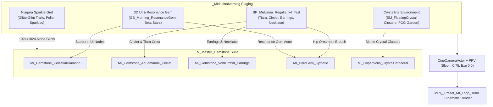

# Production Staging & Render Execution Plan: Melusina's Morning

**Target Level:** `/Game/Melodia/Levels/Opening/L_MelusinaMorning`  
**Execution Window:** Tonight's Render Session (September 30, 2026)  
**Target Output:** 1080p / 4K Portfolio & Cinematic Stills / Turnaround Loops  
**Master Shading Foundation:** `M_Master_Gemstone` + Substrate Toon BSDF  

---

## 1. Staging Architecture Overview

This plan coordinates four asset tracks in `L_MelusinaMorning` into a unified visual presentation:
1. **Melusina's Regalia (Hero Character & Jewelry)**
2. **3D UI & Resonance Gemstones**
3. **Environmental Crystal Geometries & Niagara Sparkle Emitters**
4. **Cinematic Cameras, Studio Lighting & Movie Render Queue (MRQ)**

---

## 2. Track 1: Melusina's Regalia v4 Staging

### Asset Specification
- **Character BP:** `[BP_Melusina_Regalia_v4_Test](file:///c:/EnvironmentPortfolio/BS_GodFile/Content/Melodia/Characters/Melusina/Regalia_v4/BP_Melusina_Regalia_v4_Test.uasset)`
- **Skeletal Body:** `SK_Melusina_V2_Body` (Pose: `A_BL_Melusina_Idle_Loop` or `A_Melusina_Idle_v22` breathing loop)
- **Hair Mesh:** `SK_MelusinaHair` (WaterHair dynamic physics)

### Material Assignment Matrix
| Accessory / Component | Static Mesh Asset | Assigned Material Instance | Visual Intent |
| :--- | :--- | :--- | :--- |
| **Circlet** | `SM_Regalia_v4_Circlet` | Slot 0: `M_Regalia_v4_Gold` Slot 1: `MI_Gemstone_Aquamarine_Circlet` | Warm gilded anime band with aquatic blue facet refraction. |
| **Tiara** | `SM_Regalia_v4_Tiara` | Slot 0: `M_Regalia_v4_Gold` Slot 1: `MI_Gemstone_CelestialDiamond` | Crown focal point with maximum diamond fire ($IOR = 2.42$). |
| **Earrings** | `SM_Regalia_v4_Earrings` | Slot 0: `M_Regalia_v4_Gold` Slot 1: `MI_Gemstone_VoidOrchid_Earrings` | Prismatic lavender teardrops reacting to grazing backlight. |
| **Necklace** | `SM_Regalia_v4_Necklace` | Slot 0: `M_Regalia_v4_Gold` Slot 1: `MI_Gemstone_VoidOrchid_Earrings` | Pendant stones matching earrings with subtle Chladni dispersion. |
| **Hip Brooch / Gown Accent** | Dynamic Socket Mesh | `MI_HeroGem_Cymatic` | Audio-reactive harmonic standing-wave lines with star nodes. |

---

## 3. Track 2: 3D UI & Resonance Gemstones

### A. Level Resonance Gem Actor
- **Actor:** `GB_Morning_ResonanceGem` (currently located at `X: -836.2, Y: 1173.9, Z: 160.9`)
- **Mesh:** `/Game/Greybox_Kit/SM_Greybox_Gem`
- **Current State:** Placeholder `MI_Material_025 / 010`
- **Action:** Replace Slot 0 with `MI_HeroGem_Cymatic` and Slot 1 with `MI_Gemstone_CelestialDiamond` to transform the greybox object into an emissive cymatic hero relic.

### B. 3D Rhythm & Interface Elements
- **3D Starburst Gems (`M_SDF_StarburstGem`):**
  - Bind `MI_SDF_StarburstGem` to use the `M_Master_Gemstone` micro-sparkle parameters (`SparkleThreshold = 0.82`, `SparkleIntensity = 1.8`).
- **Beat Star Markers (`MI_NS_ChoralSheep_BeatStar`):**
  - Re-verify 1024×1024 high-resolution alpha texture and set emissive scale multiplier to match scene exposure.
- **Dialogue & Frame Trims (`M_MelodiaUI_DialogueFrame`):**
  - Stage gemstone bevel accent using `MI_Gemstone_Aquamarine_Circlet` for diegetic fantasy UI framing.

---

## 4. Track 3: Environmental Crystals & Glitter Systems

### A. Crystal Shards & Formations
- **PCG Biomes:** `Massive_Biome_CrystalGarden`, `Massive_Biome_CrystalGarden2`, `Massive_Biome_CrystalGarden3`
- **Hero Clusters:** Populate `SM_FloatingCrystal_Cluster_A/B/C` and `SM_FloatingCrystal_Shard_A/B` along the foreground framing edges.
- **Material Binding:**
  - Base Body: `MI_Copernicus_CrystalCathedral` (refreshed and compiled; internal facet frequency = 8).
  - High-Clarity Shards: `MI_Universal_CrystalClear` and `MI_FloatingCrystal_Iridescent`.

### B. Niagara Glitter Systems
- **Emitters in Scene:**
  - `GlitterGlint_SkirtHollow` (Z: 96.3)
  - `GlitterGlint_WalkwayTrail` (Z: 287.8)
  - `GlitterGlint_MeadowSpill` (Z: 793.1)
  - `FX_Morning_Bed_PollenSparkle` (Z: -141.9)
- **Status:** White square defect resolved. Emitters now reference verified 1024×1024 diamond sparkle textures (`NeverStream = True`, `TEXTUREGROUP_Effects`).
- **Lighting Interaction:** Ensure point lights `Dress_LanternLight_0/1` catch sparkle particles in near-camera foreground.

---

## 5. Track 4: Cinematic Lighting, Cameras & PPV Recipe

### A. Camera Setup
- **Hero Stills / Macro Portait:**
  - Use `CAM_Hero_01_Meadow` or `CAM_MelusinaMorning_Portfolio` (focal length: 85mm, Aperture: $f/2.2$ for soft creamy bokeh behind the sharp gemstone facets).
- **Environment Framing:**
  - `CAM_Hero_03_RimOverlook` & `RENDERCAM_FLOATING_ISLANDS` for wide composition with floating crystal formations.

### B. Three-Point Lighting for Gems
1. **Accent Backlight / Rim Light (15–25 Lux, Cool Cyan `#A8E6FF`):**
   - Positioned at high rear oblique angle to excite `DispersionSpread` (0.045) and produce vibrant prismatic edges.
2. **Key Light (Soft Warm `#FFF8EE`, Specular Scale 1.2):**
   - Focused on Melusina's circlet and necklace to trigger specular fire across Voronoi facet cells.
3. **Fill / Ambient Floor:**
   - Kept subtle (0.2–0.3 ratio) to preserve dark absorption extinction depths inside the crystals.

### C. Post-Process Volume Calibration
- **Bloom Method:** Standard or Convolution
- **Bloom Threshold:** `0.78` (strictly isolates the glints, preventing wash-out)
- **Bloom Intensity:** `0.65`
- **Exposure Bias:** `0.0 EV` (prevents PNG overexposure)
- **Chromatic Aberration:** `0.35`
- **Vignette:** `0.22`

---

## 6. Implementation & Staging Execution Steps

1. **Step 1 — Spawn & Position Regalia Actor:**
   Execute Python script via Monolith to spawn `BP_Melusina_Regalia_v4_Test` at `CAM_Hero_01_Meadow` target coordinates, assign idle animation montage, and confirm socket alignment.
2. **Step 2 — Apply Gemstone Material Overrides:**
   Bind `MI_Gemstone_Aquamarine_Circlet`, `MI_Gemstone_CelestialDiamond`, `MI_Gemstone_VoidOrchid_Earrings`, and `MI_HeroGem_Cymatic` to character components and `GB_Morning_ResonanceGem`.
3. **Step 3 — Stage Crystal Geometries:**
   Place 3 floating crystal clusters (`SM_FloatingCrystal_Cluster_A/B`) in the foreground framing zone of `CAM_Hero_01_Meadow` and apply `MI_Copernicus_CrystalCathedral`.
4. **Step 4 — Lighting & Test Frame Capture:**
   Capture full-resolution test frames via `editor_query:capture_scene_preview` from all 5 active CineCameras to verify lighting and facet reflections.
5. **Step 5 — Batch MRQ Render Queue:**
   Queue 120-frame turntable/cinematic takes to `Saved/Portfolio/Renders/` using `MRQ_Preset_MI_Loop_1080`.
