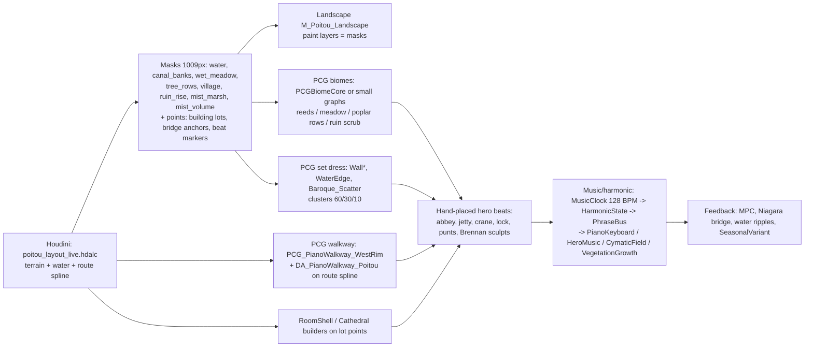

# Poitou: "Melusina's First Day". Convergence plan (v1, 2026-10-20 ET)
Scope: L_Poitou_v2, 1 km core, 7-beat route, "Musical but French" (style_contract.md). Inventory: PROJECT_INVENTORY.md. **Rule: reuse existing systems first; no new C++ this week.** Every claim is either linked to a source, taken from the project files, or marked **[I]** (inference). All numbers are **targets**, not measured values.

## 0. Infold practice (from Nikki brief)
Full detail: /workspace/poitou_board/INFOLD_PIPELINE_FACTS.md, INFINITY_NIKKI_BRIEF.md, INFINITY_NIKKI_BRIEF_v2.md, SOURCES.md. Items we adopt:
- Stock UE first, custom code only where the look needs it ([UE interview](https://www.unrealengine.com/developer-interviews/behind-the-scenes-of-infinity-nikki-tracing-a-glamorous-turn-to-an-unreal-open-world)). Environment stays PBR/Lumen; the toon read comes from shapes.
- The map-design "impossible triangle": aesthetics, world consistency, platforming ([AUTOMATON, GDC 2026](https://automaton-media.com/en/column/infinity-nikki-level-designer-talks-about-philosophy-behind-large-scale-gameplay-and-map-expansions-in-version-2-0/)). Each beat below is tagged with its priority corner.
- Location-tied BGM that transitions as the player moves, with accordion in the orchestration ([Wikipedia](https://en.wikipedia.org/wiki/Infinity_Nikki)).
- [I] Procedural foliage fields, with hand-placed hero vignettes at the nodes.

## 1. Target pipeline

## 2. Existing system → First Day role
| System (path in inventory) | Role | Verdict |
|---|---|---|
| Houdini layout HDA + export masks (box houdini/) | Single source of terrain, water, route, lots | **Reuse** (authoritative) |
| HDA MelodiaRoomShell_1.0, ArpeggioStair_1.0, PCG_MelusinaRoomShell_PCGex | Village houses/barns on lot points; ArpeggioStair → steps on rise | **Reuse**; style the params per style_contract |
| PCG_CathedralGrammar_Nave / PCG_CathedralNave / SM_Cathedral_* | Church (beat 4), Maillezais abbey ruin (beat 7) | **Extend** (Romanesque params, 2.4 m bays) |
| APCGPianoKeyboard + Profile, PCG_PianoWalkway_WestRim / _InfiniteScore, PCG_PianoKeyRun_2Oct | Footbridge (beat 2) and lock walkway (beat 6) | **Reuse**; new DA_PianoWalkway_Poitou only |
| APCGMusicStepGrid + UPCGMusicStepGridProfile | Church-square paving "sequencer" puzzle (beat 4) | **Reuse** (new profile DA) |
| APCGHeroMusicNode / AMelodiaPlayableDecorNode, BellTreeGarden host | Bells, crane pulleys and lock gear as playable decor | **Reuse**; ResonanceCathedralHost for abbey finale |
| UMelodiaMusicClockSubsystem / HarmonicStateSubsystem / PhraseBus | Global tempo, per-zone key, cue crossfade (≥10 m) | **Reuse** (data only) |
| UMelodiaCymaticFieldComponent, BP_CymaticFieldVolume | Water-surface ripples on bief and Grand Port | **Reuse** (subtle, near-field only) |
| MelodiaVegetationGrowthSubsystem, UMelodiaSeasonalVariantComponent | Dawn→dusk bloom/close states, meadow tint | **Extend** (ToD drives the profile) |
| Water* bridges (Ripple, Niagara, Audio, Buoyancy) | Punts, ripples, plucks on water | **Reuse** |
| BP_MelodiaPuzzleRelay/WorldChallenge_FirstResonance, StateAnchor_FirstDreamProgress, TraversalGate, StoryDoor | Gating and progress flags for the 7 beats | **Reuse** (duplicate as *_FirstDay) |
| Massive PCG_Biome* / PCG_RuntimeBiome, PCGDemo_* | Reference for the runtime biome pattern | **Reference only**, do not ship |
| Escher/Cosmic/Cyberpunk/Desert/Sakura styles, PCG_Hero_Xylophone/CrystalHarp | Off-identity (violate the silhouette ban) | **Retire** for Poitou |

## 3. Beat sheet (dawn → dusk). Route ~1.6 km, ~15–20 min
| # | Beat / ToD | Gameplay (teach one thing) | Music | Visual reveal | Corner |
|---|---|---|---|---|---|
| 1 | Jetty, 06:00 mist | Arrive by punt; walk + camera | Solo accordion drone, D | Steeple A faint through the mist | beauty |
| 2 | Footbridge, 07:00 | **Step = note**: PianoWalkway D4–D5 | Melody answers each step | Mist lifts, ruin B framed by pollard ash E | platforming |
| 3 | Grand Port, 09:00 | Play the crane (HeroMusicNode); ride a punt across the bief | Accordion + harp, market rhythm | Crane C, moored barques, cymatic ripples | consistency |
| 4 | Church square, 12:00 | StepGrid paving puzzle opens the StoryDoor (FirstResonance relay) | Bells join on beat 1 of the bar | Steeple overhead; the first full abbey view in the frame | consistency |
| 5 | Quéreux lane, 14:30 | Free explore; collectibles at balais steps | Thinned to guitar/accordion | Lane drops to a conche; lock D to the east | beauty |
| 6 | Poplar allée + lock, 17:00 | Lock gate = TraversalGate; walkway across the lock | Rising ostinato (128 BPM) | Allée vanishing point = ruin; long shadows | platforming |
| 7 | Ruin on rise, 19:30 dusk | ArpeggioStair climb → ResonanceCathedral finale | Full tutti, then silence | Reverse view: marsh, steeple, mist bands | beauty |
Gating [I], following common JRPG onboarding practice: a linear golden path through beats 1–3; the first optional branch at beat 5; the landmark (abbey) visible from ≥70% of the walkable area (style_contract target); a secondary landmark every 150–200 m.

### Animation layer (Animation Expert). PLACEHOLDER, AE to fill

See full animation layer: `ae_first_day_animation_layer.md` (19 reused clips, 9 new; punting pole = existing `/Game/Melodia/Meshes/Poitou/SM_Poitou_Pigouille`).

| # | Melusina locomotion / idles | Ambient loops (BP_Poitou_SpanBob, poplar sway, birds) | Interaction anims (key press, crane, lock) | Cinematic beats |
|---|---|---|---|---|
| 1–7 | _TBD (AE)_ | _TBD_ | _TBD_ | _TBD_ |

## 4. PCG graph plan
| Graph (new = dup of) | Inputs / attributes | Partitioned | Mode |
|---|---|---|---|
| PCG_Poitou_Biome (dup PCG_Melodia_MassiveBiome; or PCGBiomeCore) | Texture data: wet_meadow, mist_marsh, tree_rows; exclusions water + route + 4 m (PCG_ExclusionFalloff) | Yes, WP grid | Editor-generated, baked |
| PCG_Poitou_CanalEdge (dup PCG_WaterEdgeScatter) | canal_banks falloff, water spline; PCGEx path offset | Yes | Editor |
| PCG_Poitou_PoplarRows (PCGEx path resample, 6–7 m) | tree_rows mask, canal splines −5 m | Yes | Editor; HLOD for far bands |
| PCG_Poitou_VillageDress (PCG_WallMoss/Lichen/Ivy, Baroque_Scatter re-meshed) | Lot points, `zone`, `era` attribs | No (small) | Editor |
| PCG_Poitou_RuinRise (dup PCG_OvergrownRuins) | ruin_rise radial | No | Editor |
| PCG_PianoWalkway_Poitou (dup WestRim) + DA_PianoWalkway_Poitou | Route spline segments tagged `walkway` from the HDA | No | Editor; keys are actors (runtime-interactive) |
| PCG_Poitou_Ambient (Niagara interop) | mist_volume, `tod` | Runtime hierarchical, small radius | Runtime |
Notes: PCG + World Partition partitioning and runtime hierarchical generation are documented by Epic ([WP](https://dev.epicgames.com/documentation/unreal-engine/using-pcg-with-world-partition-in-unreal-engine?lang=en-US), [runtime hierarchical](https://dev.epicgames.com/documentation/en-us/unreal-engine/runtime-hierarchical-generation)). **UE 5.8 on fromage has PCGBiomeCore + PCGBiomeSample (Experimental) listed in the uproject plugin list (enabled flag not checked)**, plus the Nanite Assemblies, FastGeo, Water and Niagara PCG interops. Partitioning of *local* biomes "not before at least 5.8" ([forum](https://forums.unrealengine.com/t/pcg-biomes-v2-partitioning-for-local-biome-graphs/2680350)) is unverified in our build. **Default: several small mask-fed graphs**; TAL tests Biome Core in phase 2. Ship baked (editor) for everything static [I].

## 5. AAA quality bars + perf budgets (targets)
- Read: abbey silhouette at 1 km; ≤4 terrain layers in view; albedo 0.08–0.85; fog to ~40% far contrast; no musical shape changes an outline (contract).
- Composition: clusters ≤6 m, 60/30/10, ≥12 m gaps; one framed reveal per beat; a 3-frame weekly art benchmark.
- Perf (targets, PC High): 60 fps @1440p; GPU ≤16.6 ms; ≤3k draw calls in view; foliage via Nanite/ISM; far poplar bands via HLOD and cards (>800 m); PCG runtime gen ≤1 ms/frame; audio voices ≤32. A Low scalability tier halves PCG density [I].
- Music: zone crossfades ≥10 m, quantised to the bar (2.4 m / 128 BPM); key-press latency feels instant (target <50 ms).

## 6. Build order (next week)
| Day | TAL | Material Artist | Animation Expert | Nikki | Brennan |
|---|---|---|---|---|---|
| Wed | Finish terrain + 8 mask layers; route spline tags from the HDA | MI_Poitou_* ×6 scripts | Fill the Animation layer table | Placeholder→mesh mapping | Approve the retire list |
| Thu | PCG_Poitou_Biome/CanalEdge/PoplarRows (small graphs) | Poplar band MIs + far fade | SpanBob, poplar sway | Beat ref frames ×7 | Pollard ash, punt |
| Fri | DA/PCG_PianoWalkway_Poitou on beats 2+6; Biome Core test | Oak/Tarred key MIs | Key-press / crane anims | Zone music cue list (accordion) | Lock/bridge details |
| Mon | RoomShell + Cathedral on lots; StepGrid at beat 4 | Lime-wash variants | Melusina idles per beat | Benchmark frames review | Ruin pieces |
| Tue | Harmonic/PhraseBus zone data; ToD 06:00→19:30 | Fog/mist volumes | Cinematic beats 1+7 | Golden-path playtest notes | Square props; sign-off |
