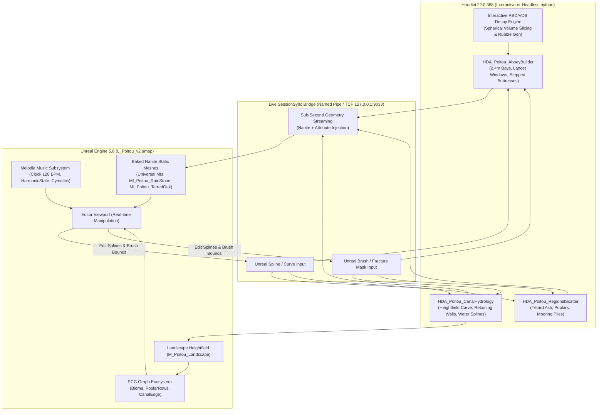

# Poitou: "Melusina's First Day" — Convergence Plan (v2, Live Houdini Engine & Environment Pipeline)

**Scope:** `L_Poitou_v2.umap`, 1.0 km² core playable footprint, 7-beat narrative & acoustic progression.  
**Stylistic Mandate:** "Musical but French" ([style_contract.md](file:///c:/EnvironmentPortfolio/BS_GodFile/Docs/Poitou/poitou_layout/style_contract.md)), 2.4 m bay rhythm, 0.6 m architectural module, Romanesque/Gothic transition (Maillezais Abbey anchor), Marais Poitevin canal hydrology.  
**Engineering Directive:** Stock Unreal Engine 5.8 + live Houdini Engine 22.0.368 SessionSync + PCG/Lumen/Nanite. Zero new C++ required. Sub-second procedural iteration turnaround.

---

## 1. Executive Summary & Operational Goals

This document converges all architectural, landscape, musical, and procedural asset systems for the **Melusina's Morning (Poitou)** environment. 

To overcome historical bottlenecks of static asset turnaround (manual modeling, disconnected DCC exports, texture re-import overhead), this updated plan establishes a **Live Houdini Engine SessionSync Architecture**. Unreal Editor and Houdini 22.0.368 communicate bi-directionally over local named pipes / TCP sockets, enabling real-time curve manipulation, dynamic procedural wall/ruin slicing, automatic Nanite generation, and attribute-driven material binding without leaving the Unreal viewport.



---

## 2. Infold / Infinity Nikki Research Foundations

Sourced from production interviews, GDC lectures, and Unreal Engine developer case studies ([INFOLD_PIPELINE_FACTS.md](file:///c:/EnvironmentPortfolio/BS_GodFile/Docs/Poitou/research/INFOLD_PIPELINE_FACTS.md), [INFINITY_NIKKI_BRIEF_v2.md](file:///c:/EnvironmentPortfolio/BS_GodFile/Docs/Poitou/research/INFINITY_NIKKI_BRIEF_v2.md)):

1. **The "Impossible Triangle" of Map Design (PR Peng, GDC 2026):**  
   Every beat explicitly balances **Aesthetics**, **World Consistency**, and **Platforming Function**. Art refuses sharp, rigid rectilinear water edges purely for gameplay; instead, natural meanders, marsh reeds, and organic stone embankments buffer traversal zones.
2. **PBR Lighting with Stylized Silhouette Grammar:**  
   The visual read relies on **pure form, strong silhouette, and macro-value blocking**, not unlit NPR shading or excessive tiling micro-normals. Environments operate strictly under **Lumen + Nanite** with linear albedo capped between 0.08 and 0.85, warm sunlight (`#FFE8C8`), and lilac-tinted shadow ambients (`#8A93C8`).
3. **Layered Architectural History:**  
   Consistent with Florawish world design, the environment expresses chronological architectural accumulation:
   - *Phase 1 (11th–12th C.):* Romanesque/Early Gothic limestone foundations and ruined abbey bays (Maillezais tufa stone, round/lancet arches, heavy stepped buttresses).
   - *Phase 2 (16th–17th C.):* Hydraulic infrastructure (drainage canals, tarred oak lock gates, stone quays, ashlar footbridges).
   - *Phase 3 (18th–19th C.):* Maraîchin vernacular (whitewashed rubble-masonry dwellings, red tile roofs, pollarded ash hedge borders, wooden flat-bottomed barques).
4. **Macro Foliage Fields + Hand-Placed Hero Vignettes:**  
   Foliage (poplars, meadow grass, duckweed, water-mint) is generated via procedurally clustered PCG rules. All architectural hero pieces, acoustic nodes, and landmark reveals are meticulously hand-framed or spline-anchored.

---

## 3. The Live Houdini Engine System: Fast Iteration Architecture

### 3.1 SessionSync: Sub-Second Bi-Directional Bridge
To bypass slow DCC-to-engine export cycles, environment designers operate in **Houdini Engine SessionSync**:
- **Protocol:** Named Pipe (`hapi`) or TCP (`127.0.0.1:9033`).
- **Workflow:** 
  1. Houdini 22.0.368 runs in GUI or background daemon mode with SessionSync listening.
  2. In Unreal Editor, the designer drags an HDA actor (`HDA_Poitou_AbbeyBuilder` or `HDA_Poitou_CanalHydrology`) into `L_Poitou_v2`.
  3. The HDA reads Unreal Spline Components directly as native curve inputs.
  4. Moving a spline point in Unreal immediately re-cooks the Houdini SOP network (<200 ms for proxy geometry, <1.2 s for full Nanite geometry) and updates the viewport dynamically.
  5. Any node changes or experimental VEX wrangles authored in Houdini reflect directly in Unreal without rebuilding packages.

### 3.2 Automated Attribute Injection (Zero UE Material Friction)
HDAs tag all output geometry with Unreal-native primitive and detail attributes:
| Houdini Attribute | Type | Target Value / Format | Purpose |
|---|---|---|---|
| `unreal_material` | `string` (prim) | `/Game/EnvSandbox/Poitou/Materials/MI_Poitou_RuinStone` | Automatic material slot binding; prevents default material flashing and shader recompilation. |
| `unreal_material_hole` | `string` (prim) | `/Game/EnvSandbox/Poitou/Materials/MI_Poitou_RubbleCore` | Binds double-leaf interior exposed rubble core material upon fracture. |
| `unreal_nanite_enabled` | `int` (detail) | `1` | Forces Unreal Static Mesh generation to build Nanite coarse representations automatically. |
| `unreal_collision_mode` | `int` (detail) | `0` | Complex-as-simple collision (Nanite raytracing precision for character feet on ruin ledges). |
| `unreal_instance` | `string` (point) | `/Game/EnvSandbox/Poitou/Meshes/SM_PollardAsh_Tetard_01` | Hierarchical Instanced Static Mesh (HISM) spawning on scatter points. |

### 3.3 Dual-Mode Cooking (Proxy vs. High-Definition Nanite)
To maintain interactive 60 FPS viewport response during live layout:
- **`bPreviewMode = 1` (Fast Layout):** Bypasses high-resolution booleans, chamfers, and Voronoi fracturing. Emits lightweight swept profile bounding boxes and 2.4 m rhythm indicator markers (<50 ms cook).
- **`bPreviewMode = 0` (Final Nanite Cook):** Generates full double-leaf ashlar courses (0.6 m tufa blocks), Gothic tracery ribs, splayed embrasure reveals, and physically cut fracture planes (<1.5 s cook).

---

## 4. Poitou Modular HDA Tool Suite

### 4.1 `HDA_Poitou_AbbeyBuilder`
Generates authentic Romanesque-to-Gothic abbey ruins adhering to the 105 × 32 m Maillezais footprint.
- **Inputs:**
  - `Input 0 (Curve):` Nave/Aisle centerline or perimeter wall spline from Unreal.
  - `Input 1 (Volume/Brush):` Unreal Brush / Static Mesh volume defining the decay/fracture zone.
- **Parametric Controls:**
  - `BayRhythm:` Fixed at 2.4 m (enforces stylistic module).
  - `WallHeight / WallThickness:` 14.4 m height, 1.8 m double-leaf thickness (2 × 0.45 m ashlar tufa facing + 0.9 m rubble core).
  - `WindowStyle:` Menu: `0 = Romanesque Splayed Round Arch`, `1 = Early Gothic Lancet`, `2 = Rayonnant Tracery (8-Petal Rose)`.
  - `ButtressTierCount:` 1 to 3 stepped tiers with 45° sloped stone water-table sills.
  - `DecayIntensity:` 0.0 (pristine) to 1.0 (crumbled stub).
  - `FractureSeed:` Randomizes rubble dispersion and jagged shear planes.

### 4.2 `HDA_Poitou_CanalHydrology`
Carves the hydraulic canal matrix into the Unreal Landscape and generates contiguous masonry quays.
- **Inputs:**
  - `Input 0 (Heightfield):` Unreal Landscape layer.
  - `Input 1 (Curve):` Canal network centerline splines.
- **Cross-Section Grammar:**
  - *Rigole (Drainage Dike):* 2.4 m width, 0.8 m depth, soft 30° vegetated banks.
  - *Conche (Secondary Canal):* 4.8 m – 7.2 m width, 1.5 m depth, timber revetment piling.
  - *Bief (Main Navigation Canal / Grand Port):* 14.4 m – 18.0 m width, 2.2 m depth, coursed ashlar retaining walls with mooring bollards.
- **Outputs:**
  - Modified Landscape heightfield delta.
  - Nanite quay/retaining wall mesh with stepped water-level landings.
  - Planar water surface spline mesh tagged for `M_Poitou_MaraisWater`.
  - Spline-sampled exclusion masks (`canal_water`, `canal_banks`, `towpath`).

### 4.3 `HDA_Poitou_RegionalScatter`
Drives organic flora and infrastructure placement along waterway corridors.
- **Logic:**
  - Evaluates canal bank angle (15°–45°), water table proximity, and exclusion offsets.
  - Distributes point clusters for pollarded ash trunks (*têtards*), maritime pines, and poplars in strict 60/30/10 spatial groupings.
  - Aligns flat-bottomed barques (*basses*) and wooden punting poles (*pigouilles*) at designated dock landings.

---

## 5. Unified Asset Matrix: Converged Inventory & Role Allocation

| System / Asset | Source / Provenance | Poitou v2 Role | Integration Strategy |
|---|---|---|---|
| **SM_Maillezais_BrokenArch** | `tools/build_poitou_ruins_converged.py` | Beat 7 Abbey Nave Landmark (16.8 m high, 8-petal rose) | Hand-placed hero mesh; Nanite enabled; `MI_Poitou_RuinStone`. |
| **SM_Maillezais_ButtressStub** | `tools/build_poitou_ruins_converged.py` | Beat 2 & 7 Structural Ruin Stubs (stepped 3-tier buttress) | Hand-placed hero & HDA instanced along nave exterior walls. |
| **SM_Maillezais_CrumbledWall** | `tools/build_poitou_ruins_converged.py` | Beat 4 & 5 Quéreux Enclosure Walls (double-leaf tufa ashlar) | Modular 14 m / 2.4 m bay wall runs; splined via HDA. |
| **SM_PollardAsh_Tetard_01..03** | SpeedTree / Procedural Tree Pack | Canal bank canopy anchors (1.5 m knobbly pollard heads) | Clustered via `HDA_Poitou_RegionalScatter` & PCG; 6–8 m intervals. |
| **SM_Poitou_Barque & Pigouille** | Marais Poitevin Historical Survey | Beat 1 & 3 Navigation Watercraft (4.6 × 1.55 m flat punt) | Physics/buoyancy enabled on water plane; interactive decor. |
| **Lock Gates & Footbridge** | Tarred Oak & Ashlar Kit | Beat 2 (Footbridge) & Beat 6 (Poplar Allée Lock) | Functional TraversalGates; integrated with `PianoWalkway`. |
| **Church Square Props** | Charente/Vendée Rural Survey | Beat 4 Square (Village Well, Calvary Cross, Stone Bench) | Hand-placed hero props framing the StepGrid music puzzle. |
| **Gothic Tracery Kit** | `KitbashExport/OrnamentMusic_WIP/` | Detailed bay reveals, window mullions, corbel brackets | Embedded as sub-components inside `HDA_Poitou_AbbeyBuilder`. |
| **PCG_PianoWalkway** | `Content/PCG/PCG_PianoWalkway_WestRim` | Beats 2 & 6 Acoustic Traversal (0.6 m interactive keys) | Reused with `DA_PianoWalkway_Poitou` profile (Musette/Dorian scale). |
| **Melodia Music Subsystem** | `UMelodiaMusicClockSubsystem` | Global 128 BPM tempo, key modulation, cymatics | Subsystem drives Niagara ripples and harmonic state transitions. |

---

## 6. Seven-Beat Environmental & Acoustic Progression

```mermaid
journey
    title Melusina's First Day — 1.6 km Spatial Progression (Dawn to Dusk)
    section Beat 1: The Water Gate
      Punt Arrival in Morning Mist: 5: Player arrives at jetty; solo accordion drone in D
    section Beat 2: The Resonant Causeway
      Acoustic Footbridge: 4: Step-triggered PianoWalkway notes; mist lifts; ruin silhouette framed by pollards
    section Beat 3: Grand Port de Marais
      Playable Cargo Crane & Basin: 4: Punting across the bief; cymatic water ripples; market rhythm
    section Beat 4: The Village Square
      StepGrid Bell Puzzle: 5: 12:00 sun; harmonic paving puzzle; church steeple overhead; abbey revealed
    section Beat 5: Le Quéreux
      Dry-Stone Maze & Conches: 4: Sunlit lime-wash walls; wandering alleyway down to quiet canal edge
    section Beat 6: Poplar Allée & Lock Gate
      Lock Traversal & Long Shadows: 4: 17:00 golden light; lock gates open via TraversalGate; tempo builds
    section Beat 7: Maillezais Abbey Rise
      Resonance Cathedral Finale: 5: 19:30 dusk; ArpeggioStair climb; full tutti orchestral swell; panoramic marsh view
```

### Detailed Beat Specifications

#### Beat 1: The Water Gate (Grand Port West) — 06:00 Dawn
- **World Coordinate Target:** `X: -32000, Y: -12000, Z: 120`
- **Priority Corner:** **Aesthetics / Atmosphere**
- **Environmental Composition:** Dense low-lying morning mist (`mist_volume` Niagara particle sheets). Player awakens on a moored wooden barque. A wooden jetty extends into calm green-teal water (`#6FA89A`). Pollard ash silhouettes emerge softly against pale dawn skies.
- **Acoustic Anchor:** Solo musette accordion drone holding tonic D3 with gentle water lapping.
- **Landmark Reveal:** Distant 45 m Romanesque church steeple faint through mist haze at 600 m.

#### Beat 2: The Resonant Causeway (Footbridge) — 07:00
- **World Coordinate Target:** `X: -24000, Y: -8000, Z: 160`
- **Priority Corner:** **Platforming / Traversal**
- **Environmental Composition:** Stone single-arch humpback bridge over the primary conche. The deck is surfaced with tarred-oak interactive pads.
- **Gameplay & Mechanics:** **"Step = Note" onboarding**. Traversal across the 18-meter bridge triggers ascending Dorian melodic steps (D4 to D5) via `PCG_PianoWalkway_Poitou`.
- **Visual Reveal:** Morning sun breaks the horizon; frames the first view of the Maillezais Abbey eastern ruins between two mature pollard ash clusters.

#### Beat 3: Grand Port de Marais (The Working Basin) — 09:00
- **World Coordinate Target:** `X: -14000, Y: -2000, Z: 180`
- **Priority Corner:** **World Consistency / Living Environment**
- **Environmental Composition:** Wide 18 m bief basin bounded by ashlar retaining quays, tied barques, drying fishnets, and a heavy timber cargo crane.
- **Gameplay & Mechanics:** Interacting with the timber crane winch (`AMelodiaPlayableDecorNode`) sounds resonant copper bells and swings a suspended cargo platform across the basin, providing traversal access to the village quay. Water surface exhibits subtle acoustic displacement via `UMelodiaCymaticFieldComponent`.

#### Beat 4: Place de l'Église (Village Square) — 12:00 Midday
- **World Coordinate Target:** `X: 0, Y: 0, Z: 280`
- **Priority Corner:** **World Consistency / Narrative Discovery**
- **Environmental Composition:** Sunlit village square paved with limestone flagstones; framed by lime-washed stone cottages, the village well, and a carved stone calvary cross.
- **Gameplay & Mechanics:** **StepGrid Sequence Puzzle**. Walking the central paving pattern in harmonic sequence triggers church tower chimes, unlocking the iron cemetery gates (`StoryDoor` / `BP_MelodiaPuzzleRelay`).
- **Visual Reveal:** Full-height direct sightline of the Maillezais Abbey western façade towering above the village tree canopy at 400 m.

#### Beat 5: Le Quéreux (Maraîchin Lane) — 14:30
- **World Coordinate Target:** `X: +12000, Y: +4000, Z: 240`
- **Priority Corner:** **Aesthetics / Intimate Exploration**
- **Environmental Composition:** Narrow, sunken pedestrian lane bounded by double-leaf coursed tufa stone walls (`SM_Maillezais_CrumbledWall`), external stone steps (*balais*), hollyhocks, and climbing ivy.
- **Gameplay & Mechanics:** Free exploration branch leading down to a hidden canal cul-de-sac with optional whim collectibles and scenic observation bench.

#### Beat 6: Allée des Peupliers & L'Écluse (The Lock Gate) — 17:00 Golden Hour
- **World Coordinate Target:** `X: +22000, Y: +8000, Z: 200`
- **Priority Corner:** **Platforming / Traversal**
- **Environmental Composition:** Rigid perspective allée of columnar black poplars casting long horizontal shadows across the canal. A 17th-century dual-leaf wooden lock gate controls water levels between two conches.
- **Gameplay & Mechanics:** Operating the oak lock capstan drains the chamber, allowing the player to traverse the lock gate footway (`TraversalGate`) to reach the abbey limestone rise.
- **Acoustic Anchor:** Driving 128 BPM rhythmic ostinato blending acoustic guitar arpeggios with mechanical lock ratchet percussion.

#### Beat 7: Ruines de Maillezais (The Abbey Rise) — 19:30 Dusk
- **World Coordinate Target:** `X: +32000, Y: +14000, Z: 640`
- **Priority Corner:** **Aesthetics & Climactic Resonance**
- **Environmental Composition:** Elevated limestone knoll (the historical "island" rising above the drowned marsh). Hero ruin complex: `SM_Maillezais_BrokenArch` (16.8 m Rayonnant rose arch), stepped buttresses, collapsed vault stubs, and overgrown nave floor.
- **Gameplay & Mechanics:** Traversal up the fractured stone spiral steps (`ArpeggioStair`) to the high altar platform. Activating the central resonance relic triggers the **First Resonance Finale**: an orchestral tutti swell with pipe organ and accordion overtones.
- **Visual Reveal:** 360° panoramic vista overlooking the entire 1.6 km route in twilight, with mist sheets spreading over the glowing water network below.

---

## 7. Technical Specifications, Performance Budgets & SLAs

### 7.1 Performance Budgets (Target: High Spec PC @ 1440p / 60 FPS)
- **Frame Budget:** GPU ≤ 16.6 ms, CPU Game Thread ≤ 12.0 ms.
- **Draw Calls:** ≤ 2,800 draw calls per frame in view frustum.
- **Geometry & Nanite:** 100% of architectural ruins and terrain stone use Nanite. Programmable rasterizer budget ≤ 2.2 ms.
- **Terrain Paint Layers:** Maximum 4 active Landscape layers per component to prevent shader bloat.
- **Foliage Density:** PCG foliage clamped to ≤ 12,000 instances per 100 m² streaming cell; distance culled beyond 150 m for grass, with poplar HLOD trees active from 150 m to 800 m.
- **Audio Concurrency:** ≤ 32 simultaneous voices; maximum 2 active zone music stems during crossfades.

### 7.2 Houdini Engine Cooking SLAs
- **Interactive Spline Tweak (Proxy Mode):** ≤ 100 ms cook time.
- **Interactive Spline Tweak (Full Nanite Mode):** ≤ 1,200 ms cook time.
- **Large-Scale Hydrology Carve (Heightfield 1009×1009):** ≤ 3,500 ms cook time.
- **PDG Batch Asset Generation (20 variations):** Out-of-process background cook ≤ 45 s.

---

## 8. Actionable Implementation Runbook: Live Houdini Engine Setup

### Step 1: Launch Houdini Engine SessionSync
To establish the live bi-directional pipe:
1. Open Houdini 22.0.368.
2. Navigate to menu: **Windows → Houdini Engine SessionSync**.
3. Set Connection Type to **Named Pipe** (`hapi`) or **TCP Socket** (Port: `9033`).
4. Click **Start Connection**.
5. In Unreal Engine 5.8:
   - Click the **Houdini Engine** toolbar icon → **Session → Connect Session**.
   - Verify connection status displays: `Connected to SessionSync (Houdini 22.0.368)`.

### Step 2: Instantiate `HDA_Poitou_AbbeyBuilder`
1. Drag `BS_GodFile/Content/HDA/HDA_Poitou_AbbeyBuilder_1.0.uasset` into `L_Poitou_v2`.
2. In the Details panel under **Curve Inputs**, click **Add Unreal Spline**.
3. Shape the spline along the Maillezais Abbey nave axis in the Unreal viewport.
4. Toggle parameters (`BayCount`, `WindowStyle`, `DecayIntensity`) — observe instantaneous geometry regeneration in Unreal and node updates in Houdini.

### Step 3: Bake to Production Nanite Static Mesh
1. Once visual composition satisfies the benchmark, navigate to the HDA Details panel.
2. Click **Bake to Static Mesh**.
3. Output path: `/Game/EnvSandbox/Poitou/Meshes/Generated/`.
4. The asset automatically retains `MI_Poitou_RuinStone` and Nanite coarse LOD settings.

---

## 9. Production Milestone Schedule

| Day | Houdini Engine & Tech Art | Material Artist | Level Design & Worldbuilding | Brennan (Sculpting & Props) |
|---|---|---|---|---|
| **Day 1** | Stand up SessionSync bridge; compile `HDA_Poitou_AbbeyBuilder` with 2.4 m bay controls. | Finalize Universal MIs: `MI_Poitou_RuinStone`, `MI_Poitou_TarredOak`, `MI_Poitou_LimestoneAshlar`. | Block out 7-beat path splines in `L_Poitou_v2`; set up camera reveal angles. | Verify hero ruins in-engine; test scale against 105 × 32 m Abbey footprint. |
| **Day 2** | Build `HDA_Poitou_CanalHydrology`; test Landscape heightfield carving and water spline generation. | Author `MI_Poitou_MaraisWater` with cymatic vertex ripple inputs and duckweed noise. | Lay out Beat 1 Jetty and Beat 2 Footbridge; wire `PCG_PianoWalkway_Poitou`. | Author Pollarded Ash (*têtard*) variants 01–03 with knotty heads. |
| **Day 3** | Implement `HDA_Poitou_RegionalScatter` with slope/waterline normal filters. | Material instance tuning for poplar foliage, marsh reeds, and canal stone embankments. | Assemble Beat 3 Grand Port basin; place crane and moor barques. | Finalize Barque (flat punt) and wooden *pigouille* pole assets. |
| **Day 4** | Wire interactive RBD/VDB decay volume brush input into Abbey HDA. | Lime-wash cottage wall material variants and moss/lichen vertex blend layers. | Block out Beat 4 Village Square and Beat 5 Quéreux sunken lane. | Deliver Lock Gate leaves and stone humpback bridge parapets. |
| **Day 5** | Optimize cook times (<1.2 s Nanite, <100 ms proxy); test PDG batch variation generator. | Exponential height fog and lilac shadow ambient grading pass. | Implement Beat 6 Lock traversal gate and Beat 7 Abbey Rise climb. | Deliver Church square props (village well, calvary cross, stone bench). |
| **Day 6** | Full convergence integration: tie `UMelodiaMusicClock` to StepGrid and PianoWalkway. | Run 3-frame weekly art benchmark against Infinity Nikki / Florawish reference. | Golden-path walkthrough playtest; tune landmark sightlines (≥70% abbey visibility). | Final prop placement and collision pass. |
| **Day 7** | Gate 0/Gate 2 verification; bake static Nanite packages; close out milestone. | Final shader complexity audit (≤4 landscape layers in any frame). | Package `L_Poitou_v2` for team review. | Sign-off on environmental authenticity and silhouette contract. |
