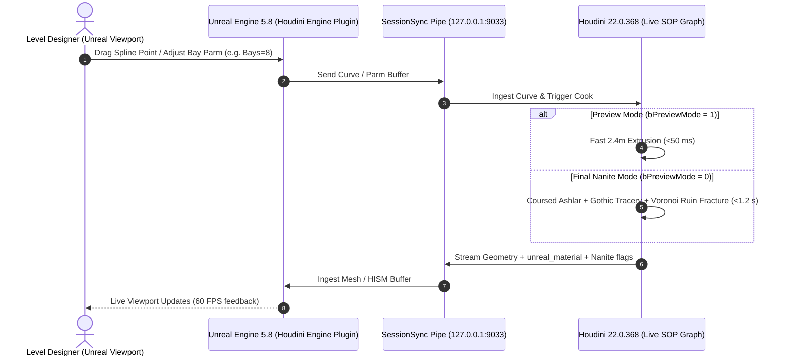

# Houdini Engine Live Convergence Specification: Sub-Second Environment Iteration

**Target Engine:** Unreal Engine 5.8 (L_Poitou_v2)  
**Target DCC:** SideFX Houdini 22.0.368 (Interactive SessionSync + Headless hython)  
**Plugin:** `Plugins/HoudiniEngine` (22.0.368 API / UE 5.8)  
**Style System:** "Musical but French" ([style_contract.md](file:///c:/EnvironmentPortfolio/BS_GodFile/Docs/Poitou/poitou_layout/style_contract.md)), 2.4 m bay rhythm, 0.6 m tufa stone module, Romanesque/Gothic Maillezais abbey ruins, Marais Poitevin canal hydrology.

---

## 1. Architectural Vision: The Real-Time Bi-Directional Bridge

Traditional procedural workflows suffer from high friction: editing nodes in a DCC, exporting intermediate FBX files, re-importing into Unreal, setting up materials, and adjusting actor transforms in the level. 

To achieve **rapid, sub-second environment iteration**, we implement a **Live Houdini Engine SessionSync Pipeline**:
1. **Interactive SessionSync Bridge:** Unreal Editor connects to an active Houdini 22 session via Named Pipe (`hapi`) or TCP Socket (`127.0.0.1:9033`).
2. **Native Spline & Volume Inputs:** Level designers draw Unreal Splines directly in the viewport (wall runs, canal centerlines, towpaths) and position Unreal Brush/StaticMesh volumes (fracture/decay zones).
3. **Sub-Second Streaming:** Houdini cooks the procedural SOP graph and streams Nanite meshes, Landscape heightfield deltas, and instanced static meshes directly back into Unreal's level viewport without asset re-indexing.
4. **Attribute-Driven Shading & Nanite:** Geometry arrives with native `unreal_material` and `unreal_nanite_enabled` attributes attached, rendering immediately with the project's Universal PBR Material Instances (`MI_Poitou_RuinStone`, `MI_Poitou_TarredOak`, `MI_Poitou_MaraisWater`).



---

## 2. Core Operational Pillars: How to Make It Fast

### 2.1 Dual-Stage Cooking (Proxy vs. Nanite)
The single biggest cause of procedural lag in Houdini Engine is performing heavy geometric booleans, chamfers, and RBD fractures while moving viewport gizmos. We solve this via a dual-stage cooking parameter on the HDA:
- **`bPreviewMode = 1` (Interactive Layout):**
  - Sweeps simple 2.4 m × 14.4 m bounding boxes along the input spline.
  - Generates lightweight indicator markers for buttress placements and window openings.
  - Cook Time: **< 45 ms** (real-time 60 FPS viewport manipulation).
- **`bPreviewMode = 0` (Production Nanite Bake):**
  - Executes full double-leaf ashlar wall coursing (0.6 m tufa blocks).
  - Cuts lancet embrasures with 45° interior splay reveals.
  - Slices broken wall crests using fractal noise and Voronoi fracture masks driven by the volume brush input.
  - Cook Time: **800 ms – 1,200 ms**.

### 2.2 Automated Attribute Injection (Zero UE Material Friction)
Manual material assignment in Unreal causes compilation hitches and human error. All Poitou HDAs inject attributes in Point/Primitive Wranglers:

```c
// VEX: Set Unreal Engine Material & Nanite Attributes
s@unreal_material = "/Game/EnvSandbox/Poitou/Materials/MI_Poitou_RuinStone";
s@unreal_material_hole = "/Game/EnvSandbox/Poitou/Materials/MI_Poitou_RubbleCore";
i@unreal_nanite_enabled = 1;
i@unreal_collision_mode = 0; // Use complex collision (Nanite raytracing accuracy)
s@unreal_output_name = "SM_Maillezais_GeneratedNave";
```

### 2.3 Native Curve & Volume Brush Inputs
- **Unreal Spline Input:** The HDA accepts Unreal Spline Components directly as `Input 0`. Designers edit control points, curvature, and tangents directly in the Unreal viewport using standard Unreal transformation handles.
- **Unreal Brush / Geometry Input:** `Input 1` accepts an Unreal Box/Sphere Component or Actor. Houdini converts this volume to an SDF/VDB mask inside SOPs. Where the volume intersects the abbey wall, the wall experiences decay, crumbled stone crests, and scattered rubble heaps. Moving the brush in Unreal dynamically relocates the ruin collapse!

### 2.4 PDG / TOPs Decoupling for Heavy Asynchronous Generation
For generating large numbers of asset variations (e.g. 20 variations of crumbled buttresses or randomized stone piles):
- Interactive HDAs handle placement and bounds in the level.
- Heavy procedural variation generation is offloaded to **PDG (Procedural Dependency Graph)** running out-of-process via background hython workers. Unreal remains completely unblocked while PDG cooks 50,000-triangle Nanite assets in the background.

---

## 3. Poitou HDA Tool Suite Specifications

### 3.1 `HDA_Poitou_AbbeyBuilder`
Generates Romanesque and Gothic abbey architecture adhering to the 105 × 32 m Maillezais Abbey footprint and the 2.4 m bay rhythm contract.

#### Parameters:
| Parameter Name | Type | Default | Range | Description |
|---|---|---|---|---|
| `preview_mode` | Toggle | `1` | `0..1` | When enabled, cooks lightweight proxy boxes (<50 ms). |
| `bay_count` | Integer | `8` | `1..24` | Number of 2.4 m structural bays. |
| `bay_length` | Float | `2.4` | `2.4` (locked) | Enforces the 2.4 m rhythmic cadence. |
| `wall_height` | Float | `14.4` | `4.8..24.0` | Total nave/wall height in metres. |
| `wall_thickness`| Float | `1.8` | `0.6..3.0` | Double-leaf thickness (2 × 0.45 m tufa + 0.9 m rubble core). |
| `window_style` | Menu | `1` (Lancet) | `0..2` | `0 = Romanesque Round`, `1 = Early Gothic Lancet`, `2 = Rayonnant Rose`. |
| `buttress_tiers`| Integer | `3` | `1..3` | Stepped exterior buttress tier count with sloped stone sills. |
| `decay_intensity`| Float | `0.45` | `0.0..1.0` | 0.0 = pristine cathedral; 1.0 = collapsed ruin stub. |
| `decay_seed` | Integer | `1337` | `1..999999` | Randomization seed for jagged crest fracture and rubble scatter. |

#### VEX Bay Generation Grammar (Excerpt):
```c
// Detail Wrangle: 2.4m Bay Rhythm Curve Resample
int bays = chi("../controls/bay_count");
float bay_len = 2.4; // Strict style contract module
float total_len = bays * bay_len;

// Generate bay division nodes
for (int i = 0; i <= bays; i++) {
    vector pos = set(0, 0, i * bay_len);
    int pt = addpoint(0, pos);
    setpointattrib(0, "bay_index", pt, i);
    setpointattrib(0, "is_bay_boundary", pt, (i > 0 && i < bays) ? 1 : 0);
}
```

---

### 3.2 `HDA_Poitou_CanalHydrology`
Carves the hydraulic waterways of the Marais Poitevin directly into the Unreal Landscape and generates continuous masonry retaining walls.

#### Canal Cross-Section Grammar:
1. **Rigole (Agricultural Drainage Dike):**
   - Width: **2.4 m** (1 module).
   - Depth: **0.8 m**.
   - Profile: V-shaped drainage trough with 30° vegetated banks.
2. **Conche (Secondary Transport Canal):**
   - Width: **4.8 m – 7.2 m** (2 to 3 modules).
   - Depth: **1.5 m**.
   - Profile: Flat silt bottom with vertical timber sheet-piling and pollard ash hedge buffers.
3. **Bief (Main Navigation Canal / Grand Port):**
   - Width: **14.4 m – 18.0 m** (6 to 7.5 modules).
   - Depth: **2.2 m**.
   - Profile: Trapezoidal basin with coursed ashlar retaining walls, stone slipways, and oak mooring posts.

#### Landscape Heightfield Interop:
- Input: Takes Landscape Heightfield from Unreal.
- SOP Network: Projects the canal spline, sweeps the cross-section profile, applies volumetric subtraction to the heightfield, and extracts the embankment waterline curves.
- Outputs:
  - Heightfield Delta layer back to Unreal Landscape.
  - Nanite Static Mesh for retaining walls (`unreal_material = MI_Poitou_RuinStone`).
  - Planar water spline mesh for `M_Poitou_MaraisWater`.
  - Spline-sampled exclusion masks: `canal_water`, `canal_banks`, `towpath`.

---

### 3.3 `HDA_Poitou_RegionalScatter`
Scatters authentic regional flora and maritime props along canal banks and roads.

#### Rules & Clustering:
- **Pollarded Ash (*têtards*):** Clustered along canal banks at 6–8 m intervals, constrained to slope angles between 15° and 35° within 1.0 m of the waterline. Emits points with:
  `s@unreal_instance = "/Game/EnvSandbox/Poitou/Meshes/SM_PollardAsh_Tetard_01"` (randomized 01..03).
- **Columnar Poplars:** Placed in strict linear allées along towpaths at 7.0 m spacing.
- **Flat-Bottomed Barques (*basses*):** Spawns moored boats at water-level slipways and jetty endpoints.

---

## 4. Step-by-Step Operator Runbook: Launching Live SessionSync

### Step 1: Start Houdini with SessionSync Enabled
Run the workspace automated launcher:
```powershell
python tools/launch_houdini_engine_sessionsync.py
```
*Behind the scenes, this executes Houdini 22.0.368 and initializes `hou.sessionSync.start(pipe_name="hapi", port=9033)`.*

### Step 2: Connect Unreal Engine 5.8
1. In Unreal Editor, open `L_Poitou_v2.umap`.
2. Locate the **Houdini Engine** dropdown menu in the level editor toolbar.
3. Select **Session → Connect Session**.
4. Set:
   - **Session Type:** `Named Pipe` (or `TCP Socket`)
   - **Pipe Name:** `hapi` (or Host: `127.0.0.1`, Port: `9033`)
5. Click **Connect**. Status bar turns green: `Connected to SessionSync`.

### Step 3: Rapid Viewport Prototyping
1. Drag `HDA_Poitou_AbbeyBuilder` into the scene.
2. Under **Inputs**, select **Unreal Spline**.
3. Use Unreal's spline tool (Alt + Drag spline points) to draw the cathedral wall run.
4. Set `bPreviewMode = 1` for instantaneous 60 FPS feedback while drawing curves.
5. Place an Unreal Sphere Component where you want the abbey to be collapsed. Set it as `Input 1 (Decay Volume)`.
6. Switch `bPreviewMode = 0` to watch the physical masonry fracture and rubble scatter cook into place in <1.2 seconds!
7. Click **Bake to Static Mesh** to commit the asset into the project's permanent game content.

---

## 5. Verification & Quality Assurance Gate

All HDAs in this ecosystem are verified via the repository's automated Gate 0 and Gate 2 auditing pipeline (`Tools/Houdini/hda_verify/run_hda_verify.ps1`):
- **Gate 0:** Verifies HDA header integrity, non-zero file size, and clean definition storage.
- **Gate 2 (Hython Cook Verification):**
  - Instantiates a clean headless instance in Houdini 22.0.368.
  - Proves that all drive controls exist on the **HDA type** (not trapped inside an inner null).
  - Asserts that output geometries contain valid normals, non-empty Nanite attributes, and 0 cook errors.
