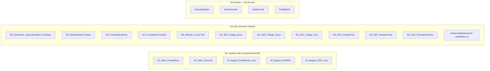

# VFX Niagara graph — Material master → MI → Niagara system (2026-09-17)

Documentary graph from git + docs + scripts. Dashed edges are inferred
(spec/script, not a live referencer query). Grey nodes are **orphans**
(no opposite-side link in-repo). Aliases that are not assets sit outside the tree.

Companion: [`VFX_NIAGARA_FULL_INVENTORY_2026-09-17.md`](VFX_NIAGARA_FULL_INVENTORY_2026-09-17.md),
[`VFX_NIAGARA_INVENTORY_2026-09-17.csv`](VFX_NIAGARA_INVENTORY_2026-09-17.csv),
[`VFX_FIXA_RISKS_2026-09-17.md`](VFX_FIXA_RISKS_2026-09-17.md).

Presence: **tracked** = LFS pointer in this clone. **ignored** = documented path,
file not in git / not on this disk.

```mermaid
flowchart TB
  subgraph FLIP["Flipbook family — M_Niagara_MelodiaFlipbook TRACKED"]
    MFlip[M_Niagara_MelodiaFlipbook]
    MIWater[MI_Niagara_MelodiaFlipbook_Water]
    MISplashF[MI_Niagara_Melodia_SplashFlip]
    MIArc[MI_Static_Arc]
    MIChaos[MI_Static_Chaos]
    MIDrop[MI_Static_DropletRing]
    MIDust[MI_Static_Dust]
    MIGlint[MI_Static_Glint]
    MIGlobC[MI_Static_GlobuleCluster]
    MIProv[MI_Static_Provider]
    MIRip[MI_Static_Ripple]
    MISig[MI_Static_Sigil]
    MISplB[MI_Static_SplashBurst]
    MIStar[MI_Static_StarGold]
    MIStateB[MI_Static_StateB]
    MFlip --> MIWater
    MFlip --> MISplashF
    MFlip --> MIArc
    MFlip --> MIChaos
    MFlip --> MIDrop
    MFlip --> MIDust
    MFlip --> MIGlint
    MFlip --> MIGlobC
    MFlip --> MIProv
    MFlip --> MIRip
    MFlip --> MISig
    MFlip --> MISplB
    MFlip --> MIStar
    MFlip -.-> MIStateB
  end

  subgraph MELUSINA["Melodia/VFX systems IGNORED"]
    NSClick[NS_Melodia_ClickSparkle]
    NSEye[NS_Melusina_EyeSparkle]
    NSGlob[NS_Melusina_Globules]
    NSSplash[NS_Melusina_Splash]
    NSRip[NS_Melusina_Ripple]
    NSArc[NS_Melusina_Arc]
    NSChaos[NS_Melusina_ChaosDrift]
    NSDust[NS_Melusina_Dust]
    NSEnt[NS_Melusina_EntropyDust]
    NSGlint[NS_Melusina_Glint]
    NSSwing[NS_Melusina_SwingTrail]
    NSProv[NS_Melusina_ProviderSigil]
    NSSup[NS_Melusina_Superposition]
    NSSig[NS_Melusina_Sigil]
    NSCursor[NS_Melodia_CursorTrail]
  end

  MFlip -.-> NSClick
  MFlip -.-> NSEye
  MIWater -.-> NSGlob
  MISplashF -.-> NSSplash
  MIRip -.-> NSRip
  MIArc -.-> NSArc
  MIChaos -.-> NSChaos
  MIDust -.-> NSDust
  MIDust -.-> NSEnt
  MIGlint -.-> NSGlint
  MIGlobC -.-> NSGlob
  MIProv -.-> NSProv
  MISig -.-> NSSig
  MISplB -.-> NSSplash
  MIStateB -.-> NSSup

  subgraph SHEEP["Choral Sheep TRACKED"]
    MIBeat[MI_NS_ChoralSheep_BeatStar]
    MIWool[MI_NS_ChoralSheep_WoolMote]
    NSBurst[NS_ChoralSheep_BeatBurst]
    NSWool[NS_ChoralSheep_WoolMotes]
    MIBeat --> NSBurst
    MIWool --> NSWool
  end
  MFlip -.-> MIBeat
  NSClick -.-> NSBurst
  NSGlint -.-> NSWool

  subgraph SAKURA_MAT["Sakura sprite family TRACKED"]
    MSak[M_Niagara_SakuraSprite]
    MIPetal[MI_Niagara_Petal]
    MIPetalI[MI_Niagara_Petal_Instance]
    MISpark[MI_Niagara_Sparkle]
    MIMote[MI_Niagara_Mote]
    MIEmber[MI_Niagara_Mote_Ember]
    MIFairy[MI_Niagara_Mote_FairyDust]
    MIWisp[MI_Niagara_Mote_GroundWisps]
    MIMist[MI_Niagara_Mote_MistSheet]
    MIWMist[MI_Niagara_Mote_WaterMist]
    MIPond[MI_Niagara_Pond]
    MIGust[MI_Niagara_Gust]
    MIGustI[MI_Niagara_Gust_Instance]
    MINeb[MI_Niagara_NebulaPetal]
    MICos[MI_Niagara_Cosmic]
    MIAur[MI_Niagara_AuroraRibbon]
    MILan[MI_Niagara_LanternGlow]
    MSak --> MIPetal
    MIPetal --> MIPetalI
    MSak --> MISpark
    MSak --> MIMote
    MIMote --> MIEmber
    MIMote --> MIFairy
    MIMote --> MIWisp
    MIMote --> MIMist
    MIMote --> MIWMist
    MSak --> MIPond
    MSak --> MIGust
    MIGust --> MIGustI
    MSak --> MINeb
    MSak --> MICos
    MSak --> MIAur
    MSak --> MILan
    MICos -.-> MIStateB
  end

  subgraph ENVSYS["EnvSandbox/VFX/Systems IGNORED"]
    NSPetals[NS_SakuraPetals]
    NSPetals2[NS_SakuraPetals_v2]
    NSGround[NS_SakuraGroundPetals]
    NSWaterP[NS_SakuraWaterPetals]
    NSGust[NS_SakuraPetalGust]
    NSDream[NS_SakuraDreamSparkle]
    NSLan[NS_SakuraLanternMotes]
    NSPondS[NS_SakuraPondShimmer]
    NSOrbit[NS_CosmicPetalOrbit]
    NSAurora[NS_SakuraCosmicAurora]
    NSWind[NS_WindRibbonGust]
    NSDraw[NS_ConstellationDraw]
    NSTwink[NS_ConstellationTwinkle]
    NSEmber[NS_EmberMotes]
    NSFairy[NS_FairyDust]
    NSTrail[NS_MagicTrail]
    NSHenshin[NS_MagicalHenshinBurst]
    NSDustS[NS_Uni_DustShafts]
    NSFire[NS_Uni_Fireflies]
    NSWisps[NS_Uni_GroundWisps]
    NSLeafD[NS_Uni_LeafDrift]
    NSMist[NS_Uni_MistSheet]
    NSPollen[NS_Uni_PollenSparkle]
    NSRain[NS_Uni_RainRipples]
    NSUniWM[NS_Uni_WaterMist]
    NSPetalLoop[NS_Melodia_PetalEndlessLoop]
    NSLeafPile[NS_Melodia_LeafPileLoop]
  end

  MIPetal -.-> NSPetals
  MIPetalI -.-> NSPetals2
  MIPetalI -.-> NSGround
  MIPetalI -.-> NSWaterP
  MIGustI -.-> NSGust
  MISpark -.-> NSDream
  MISpark -.-> NSPollen
  MISpark -.-> NSTrail
  MISpark -.-> NSHenshin
  MIMote -.-> NSLan
  MIMote -.-> NSDustS
  MIMote -.-> NSFire
  MILan -.-> NSLan
  MIPond -.-> NSPondS
  MINeb -.-> NSOrbit
  MIAur -.-> NSAurora
  MIAur -.-> NSWind
  MIAur -.-> NSRain
  MIEmber -.-> NSEmber
  MIFairy -.-> NSFairy
  MIWisp -.-> NSWisps
  MIMist -.-> NSMist
  MIWMist -.-> NSUniWM

  subgraph LOOP["Petal loop masters TRACKED"]
    MMesh[M_Niagara_PetalMesh_Loop]
    MSpriteL[M_Niagara_PetalSprite_Loop]
    MPile[M_Niagara_PetalPile]
    MSDF[M_Niagara_SDF_Loop]
    MRipple[M_Niagara_Ripple]
    MRibbon[M_SakuraRibbon]
    MMesh -.-> NSPetalLoop
    MRipple -.-> NSRain
    MRibbon -.-> NSSwing
    MRibbon -.-> NSArc
  end

  MILeaves[MI_Leaves untracked Effects]
  MILeaves -.-> NSLeafPile
  MILeaves -.-> NSLeafD

  subgraph TRACKED_NS["Other tracked NS"]
    NSSea[NS_SeaAbove_UpwardDroplets_Prototype]
    NSWcontact[NS_MelodiaWaterContact]
    NSBattle[NS_Melodia_BattleBackdropPulse]
    NSDrawC[NS_ConstellationDraw_AdvancedCandidate]
    NSTwinkC[NS_ConstellationTwinkle_AdvancedCandidate]
    NSLanC[NS_SakuraLanternMotes_AdvancedCandidate]
  end
  MICos -.-> NSBattle
```

## Orphans (no opposite-side link in this audit)

## Read rules

- Solid arrows: parent/child or named clone documented in a receipt or repair script.
- Dashed arrows: spec/manifest/script assignment; live renderer material may differ.
- `NS_ChoralSheep_BeatBurst` is the Fix A **RISK** node (Batch B SubUV on; owner claims later Fix A).
- `NS_ConstellationDraw` is drawn without a material on purpose — owner says Fix A OK;
  this audit still has no MI name for it.
- If a live Monolith referencer pass contradicts an edge, the live edge wins; update
  the CSV, not this prose, first.
