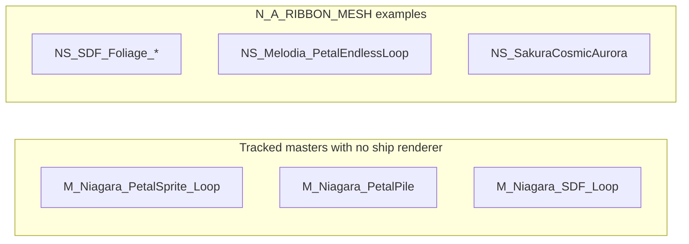

# VFX Niagara graph — Material → MI → Niagara system (2026-09-17)

LIVE_MONOLITH edges from `VFX_NS_MATERIAL_EDGES_2026-09-17.csv` and DETAIL pin
read. Solid arrows are live renderer bindings. **RISK_DOUBLE = 0.** LeafPile is
**CLEAN_FIXA** (SubUV off; SubImage **2×2 atlas kept**). Choral Sheep CLEAN_FIXA
nodes are the four systems with SubUV present-but-off and SubImage 1×1.

Companion: [`VFX_NIAGARA_FULL_INVENTORY_2026-09-17.md`](VFX_NIAGARA_FULL_INVENTORY_2026-09-17.md),
[`VFX_NIAGARA_INVENTORY_2026-09-17.csv`](VFX_NIAGARA_INVENTORY_2026-09-17.csv),
[`VFX_FIXA_DETAIL_2026-09-17.csv`](VFX_FIXA_DETAIL_2026-09-17.csv),
[`VFX_FIXA_RISKS_2026-09-17.md`](VFX_FIXA_RISKS_2026-09-17.md),
[`VFX_FIXA_LEAFPILE_2026-09-17.md`](VFX_FIXA_LEAFPILE_2026-09-17.md),
[`VFX_BEATPULSE_BP_WIRE_2026-09-17.md`](VFX_BEATPULSE_BP_WIRE_2026-09-17.md).

Scope: 65 ship NS under `/Game/Melodia` + `/Game/EnvSandbox`. Candidates / `_Archive`
excluded. LeafPile Fix A applied live (owner Ctrl+S).

```mermaid
flowchart TB
  subgraph FIXA_ATLAS["CLEAN_FIXA — LeafPile atlas 2x2 kept"]
    MILeaves[MI_Leaves]
    NSLeafPile[NS_Melodia_LeafPileLoop]
    MILeaves -->|LeafPile SubUV off 2x2 atlas| NSLeafPile
  end

  subgraph FIXA["CLEAN_FIXA_SUBUV_OFF — Choral Sheep"]
    MIBeat[MI_NS_ChoralSheep_BeatStar]
    MIPetLoop[MI_NS_ChoralSheep_PetalLoop]
    MIRibbon[MI_NS_ChoralSheep_MotionRibbon]
    NSBurst[NS_ChoralSheep_BeatBurst]
    NSHybrid[NS_ChoralSheep_HybridSparkles]
    NSCascade[NS_ChoralSheep_PetalCascade]
    NSMotion[NS_ChoralSheep_MotionTrails]
    MIBeat -->|BeatStars SubUV off 1x1| NSBurst
    MIBeat -->|FlipSparkles SubUV off 1x1| NSHybrid
    MIPetLoop -->|PetalLoop SubUV off 1x1| NSCascade
    MIRibbon -->|MotionRibbon SubUV off| NSMotion
  end

  subgraph SHEEP_CLEAN["Choral Sheep CLEAN"]
    MIWool[MI_NS_ChoralSheep_WoolMote]
    MIPetPile[MI_NS_ChoralSheep_PetalPile]
    MIGlob[MI_NS_ChoralSheep_FluidGlobule]
    MISplS[MI_NS_ChoralSheep_SplashBurst]
    NSWool[NS_ChoralSheep_WoolMotes]
    NSFluid[NS_ChoralSheep_FluidSplash]
    MIWool --> NSWool
    MIWool --> NSHybrid
    MIWool --> NSMotion
    MIPetPile --> NSCascade
    MIGlob --> NSFluid
    MISplS --> NSFluid
  end

  subgraph FLIP["Flipbook family — SubUV off / 1x1 on ship sprites"]
    MFlip[M_Niagara_MelodiaFlipbook]
    MIWater[MI_Niagara_MelodiaFlipbook_Water]
    MISplashF[MI_Niagara_Melodia_SplashFlip]
    MIArc[MI_Static_Arc]
    MIChaos[MI_Static_Chaos]
    MIDrop[MI_Static_DropletRing]
    MIDust[MI_Static_Dust]
    MIGlint[MI_Static_Glint]
    MIGlobC[MI_Static_GlobuleCluster]
    MIProv[MI_Static_Provider]
    MIRip[MI_Static_Ripple]
    MISig[MI_Static_Sigil]
    MISplB[MI_Static_SplashBurst]
    MIStar[MI_Static_StarGold]
    MIStateB[MI_Static_StateB]
    MIImpact[MI_Static_ImpactBurst]
    MIMist[MI_Static_Mist]
    MIClick[MI_Niagara_Melodia_ClickSparkle]
    MFlip --> MIWater
    MFlip --> MISplashF
    MFlip --> NSEye[NS_Melusina_EyeSparkle]
    MIWater --> NSGlob[NS_Melusina_Globules]
    MIWater --> NSWcontact[NS_MelodiaWaterContact]
    MISplashF --> NSSplash[NS_Melusina_Splash]
    MISplB --> NSSplash
    MIGlobC --> NSGlob
    MIRip --> NSRip[NS_Melusina_Ripple]
    MIDrop --> NSRip
    MIArc --> NSArc[NS_Melusina_Arc]
    MIChaos --> NSChaos[NS_Melusina_ChaosDrift]
    MIDust --> NSDust[NS_Melusina_Dust]
    MIDust --> NSEnt[NS_Melusina_EntropyDust]
    MIGlint --> NSGlint[NS_Melusina_Glint]
    MIGlint --> NSSup[NS_Melusina_Superposition]
    MIStateB --> NSSup
    MIProv --> NSProv[NS_Melusina_ProviderSigil]
    MISig --> NSSig[NS_Melusina_Sigil]
    MIStar --> NSCursor[NS_Melodia_CursorTrail]
    MIClick --> NSClick[NS_Melodia_ClickSparkle]
    MIImpact --> NSImpact[NS_Melusina_ImpactBurst]
    MIMist --> NSMist[NS_Melusina_Mist]
  end

  subgraph SAKURA["Sakura / ambient / universal — live"]
    MSak[M_Niagara_SakuraSprite]
    MPetal[M_SakuraPetal]
    MRipple[M_Niagara_Ripple]
    MRibbon[M_SakuraRibbon]
    MIAur[MI_Niagara_AuroraRibbon]
    MISpark[MI_Niagara_Sparkle]
    MIMote[MI_Niagara_Mote]
    MIEmber[MI_Niagara_Mote_Ember]
    MIFairy[MI_Niagara_Mote_FairyDust]
    MIWisp[MI_Niagara_Mote_GroundWisps]
    MIMistS[MI_Niagara_Mote_MistSheet]
    MIWMist[MI_Niagara_Mote_WaterMist]
    MINeb[MI_Niagara_NebulaPetal]
    MStarDust[M_StardustParticle_Glow]
    MMesh[M_Niagara_PetalMesh_Loop]
    MSak --> NSLan[NS_SakuraLanternMotes]
    MSak --> NSDream[NS_SakuraDreamSparkle]
    MSak --> NSTwink[NS_ConstellationTwinkle]
    MStarDust --> NSDraw[NS_ConstellationDraw]
    MPetal --> NSPetals2[NS_SakuraPetals_v2]
    MPetal --> NSGust[NS_SakuraPetalGust]
    MPetal --> NSWind[NS_WindRibbonGust]
    MPetal --> NSWaterP[NS_SakuraWaterPetals]
    MPetal --> NSGround[NS_SakuraGroundPetals]
    MPetal --> NSPetals1[NS_SakuraPetals]
    MRipple --> NSPetals2
    MRipple --> NSPondS[NS_SakuraPondShimmer]
    MRipple --> NSRain[NS_Uni_RainRipples]
    MRipple --> NSWaterFX[Melusina_WaterFX]
    MRibbon --> NSWind
    MRibbon --> NSKnot[NS_EscherTorusKnot]
    MIAur --> NSGust
    MIAur --> NSRain
    MIAur --> NSAurora[NS_SakuraCosmicAurora]
    MIAur --> NSSwing[NS_Melusina_SwingTrail]
    MIAur --> NSHenshin[NS_MagicalHenshinBurst]
    MIAur --> NSTrailRoot[NS_MagicTrail_Systems]
    MISpark --> NSTrailMag[NS_MagicTrail_Magical]
    MISpark --> NSTrailRoot
    MISpark --> NSHenshin
    MIMote --> NSDustS[NS_Uni_DustShafts]
    MIMote --> NSFire[NS_Uni_Fireflies]
    MIEmber --> NSEmber[NS_EmberMotes]
    MIFairy --> NSFairy[NS_FairyDust]
    MIWisp --> NSWisps[NS_Uni_GroundWisps]
    MIMistS --> NSMistU[NS_Uni_MistSheet]
    MIWMist --> NSUniWM[NS_Uni_WaterMist]
    MINeb --> NSOrbit[NS_CosmicPetalOrbit]
    MMesh --> NSPetalLoop[NS_Melodia_PetalEndlessLoop]
    MILeaves --> NSLeafD[NS_Uni_LeafDrift]
  end
```

`NS_Uni_LeafDrift` shares `MI_Leaves` with LeafPile and is **CLEAN** (no live SubUV).
LeafPile is **CLEAN_FIXA** — SubUV off, 2×2 atlas kept. Not RISK.

Two live `NS_MagicTrail` paths: `/Game/EnvSandbox/VFX/Systems/Magical/NS_MagicTrail`
and `/Game/EnvSandbox/VFX/Systems/NS_MagicTrail`. Both CLEAN.

HybridSparkles / PetalCascade / MotionTrails / FluidSplash are **in the sheep
subgraph**, not aliases.

## Read rules

- Solid arrows: live renderer material from the 2026-09-17 Monolith edges CSV.
- `NS_ChoralSheep_BeatBurst` is **CLEAN_FIXA**, not RISK. Batch B 4×2 / SubUV-on is superseded.
- `NS_ConstellationDraw` binds `M_StardustParticle_Glow`. Dream\* bus is not drawn here.
- `NS_Melodia_LeafPileLoop` is **CLEAN_FIXA**. SubImage **2×2 kept** (atlas). Do not claim 1×1.
- BeatPulse: `BP_ChoralSheep` Tick → `User.BeatPulse` on the six sheep NS (binary not in this PR).
