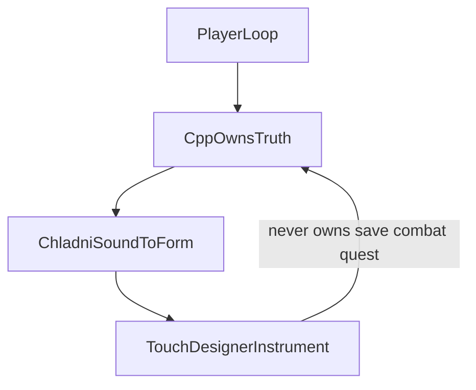
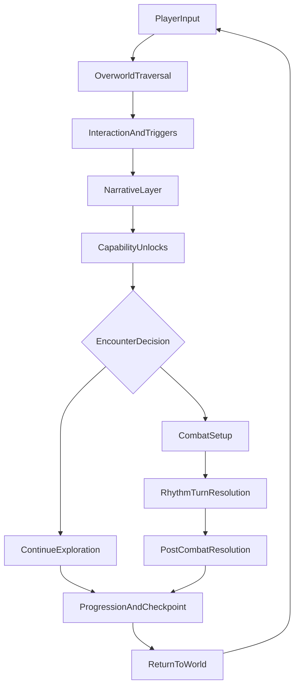
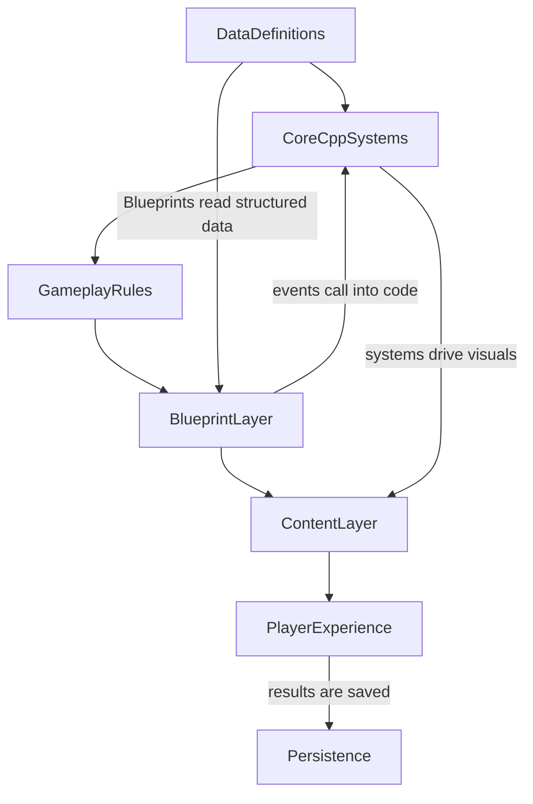
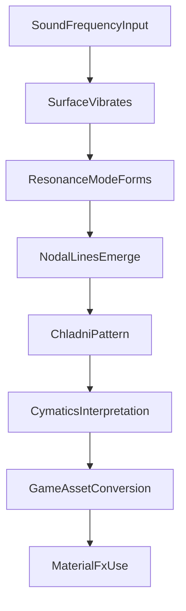
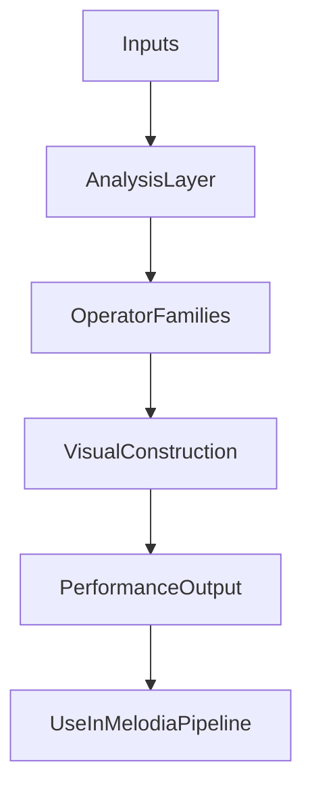

# World-Building Source of Truth

**Status:** CANONICAL WORLD-BUILDING AUTHORITY — 2026-09-09  
**Scope:** How a Melodia world/chapter is authored, what may decide truth, how music becomes visible form, and where TouchDesigner is allowed to perform.

> **C++ decides what is true. Blueprints assemble and present. Materials / Niagara / audio visualize. TouchDesigner performs. A new world is content over this stack, not a new subsystem.**

## World inventory

[**Melodia World Atlas**](../WorldAtlas/README.md) is the canonical inventory/provenance index for named worlds, routes, evidence rungs, source-control bundles and production entry points. It does **not** replace this architecture authority, `CURRENT_STATE.md`, World Compiler, Universe Foundry, UE PCG, or gameplay/save owners.

These four owner diagrams are **one stacked contract**, not four independent systems. Visual boards live in [`Docs/References/WorldBuilding/`](../References/WorldBuilding/). Current runtime status and evidence pointers live in [`CURRENT_STATE.md`](../../CURRENT_STATE.md). Sheep lookdev still obeys [`Docs/References/ChoralSheepCapstone/AGENT_CONTEXT.md`](../References/ChoralSheepCapstone/AGENT_CONTEXT.md) (Board 06 + Nikki Cymatics).



| Layer | Owner diagram | Allowed to decide | Must not become |
|---|---|---|---|
| Player loop | exploration → encounter → rhythm combat → resolution → progression | How a **world/chapter** is played | A mandatory six-phase template for every Reverie |
| Runtime ownership | Data → C++ → rules → Blueprints → content → player | What is **true** and when | Blueprint/content inventing save, combat, or quest facts |
| Sound-to-form | Chladni / cymatics 8-step pipeline | How music becomes visible world form | Generic glow, a second shader authority, or replacing Nikki Cymatics |
| Visual instrument | TouchDesigner signal → systems → visuals | Live/editorial visualization of existing truth | Gameplay brain, save owner, or a second beat clock |

---

## 1. Player loop — how a world is played




| Stage | What it does | Existing owner |
|---|---|---|
| Player Input | Movement, camera, interact, instrument use | Integration PlayerController / Enhanced Input |
| Overworld Traversal | Explore spaces, discover paths, meet characters | Authored maps + Starskiff / wardrobe traversal |
| Interaction & Triggers | Overlap volumes, interactables, quest prompts | Level actors; names, not labels |
| Narrative Layer | QuillScript events, dialogue beats, story state | `UMelodiaNarrativeSubsystem` + QuillScript (7 verbs) |
| Capability / Instrument Unlocks | New traversal powers and puzzle affordances | `UMelodiaWardrobeSubsystem` + `IMelodiaTraversalCapabilityProvider` |
| Encounter Decision | Continue exploration **or** enter rhythm combat | Quill `melodia:battle:<EncounterId>` / world trigger; combat is optional per chapter tier |
| Combat Setup | Spawn context, enemy state, combat UI, timing lane | Phoenix / TurnBased JRPG + single-writer UI |
| Rhythm / Turn Resolution | Timing windows, actions, effects, feedback | Melodia rhythm **on top of** the selected JRPG action |
| Post-Combat Resolution | Rewards, narrative consequences, state cleanup | Phoenix terminal result → Quill resumes **once** |
| Progression & Checkpoint | Save/load, unlocked content, next objective | Canonical JRPG SaveGame + `melodiaNarrativeRecord` |
| Return to World | Loop continues with richer capabilities | Same world; no second persistence authority |

Every lane feeds the same player loop. World, narrative, combat, and progression stay in sync.

First Dream's six-phase route remains the **integration proof**. It is not the only legal chapter shape. A Reverie may skip combat. A Monolith Event may skip a conventional HP bar. See [`Docs/Strategy/MELODIA_CHAPTER_TIER_AND_VOLUME_ARCHITECTURE_2026-09-02.md`](../Strategy/MELODIA_CHAPTER_TIER_AND_VOLUME_ARCHITECTURE_2026-09-02.md).

Chapter authoring starts at [`Chapters/CHAPTER_TEMPLATE.md`](../../Chapters/CHAPTER_TEMPLATE.md).

---

## 2. Runtime ownership — what is true




| Layer | Contains | Existing owner |
|---|---|---|
| Data Definitions | Enums, structs, Data Assets, tables, config | `DA_MelodiaIntegrationConfig`, progression specs, wardrobe catalog, Quill IDs |
| Core C++ Systems | Actors, components, subsystems, save, state machines | MelodiaIntegration C++ + Phoenix / JRPG template |
| Gameplay Rules | Movement, combat, companion, traversal, persistence | Same C++ owners; MelodiaCore is presentation-only this phase |
| Blueprint Layer | Designer-facing assembly, rapid iteration, event hookup | Integration BPs; no second combat/save/HUD writer |
| Content Layer | Animations, materials, UI, audio, VFX, levels | Art/content; visualizes owner state |
| Player Experience | Responsive gameplay, readable feedback, stable progression | Proven First Dream / Sea Above loop |
| Persistence | Save data, profiles, settings, world state | `BP_JRPGSaveGame` + narrative record |

Typical pattern: **C++ defines the rules; Blueprints present and connect them.**

Companions, wardrobe, combat flow, traversal powers, and saving all depend on code contracts. Architecture detail: [`SYSTEM_MAP.md`](../../SYSTEM_MAP.md) and [`DATA_FLOW.md`](../../DATA_FLOW.md).

---

## 3. Chladni / cymatics — sound to visible form




| Step | Meaning | Production mapping |
|---|---|---|
| 1. Sound / Frequency Input | Note, vibration, or signal. Pitch changes = different pattern families | Pitch class, Harmonize, instrument identity |
| 2. Surface Vibrates | Plate, membrane, string, or virtual surface | Fleece, fabric, resonance surfaces |
| 3. Resonance Mode Forms | Standing waves appear | Harmonic intensity / beat phase |
| 4. Nodal Lines Emerge | Still points organize into geometry | Pattern identity, not decoration |
| 5. Chladni Pattern | Visible geometry from resonance. Harmonics = more complex symmetry | C / E / G shared field language |
| 6. Cymatics Interpretation | Structured visual form from that data | Artistic mapping that stays musically legible |
| 7. Game Asset Conversion | Textures, masks, height maps, emissive patterns, particles | Import/promote into UE; no second material master |
| 8. Material / FX Use | Instrument motifs, sheep coat patterns, resonance surfaces, note-reactive FX | Approved Nikki Cymatics path for Sheep; MPC / Niagara for world response |

Practical workflow:

```text
frequency idea → generate pattern → clean texture → map to material parameters → animate/react in engine
```

Chladni is the pattern itself; cymatics is the broader idea of visualizing vibration.

**Sheep lock (unchanged):** `MI_ChoralSheep_Body` → `M_Master_Toon_Character`; `MI_ChoralSheep_Body_Chladni_C` inherits and consumes `T_Chladni_C_ROOT`. Do not revive `M_Chorus_Wool_Master` as P0/final authority. Engineering encyclopedia for math/tooling: [`Docs/Pipelines/MELODIA_CYMATICS_MONOLITH_HOUDINI_EMERGING3D_PIPELINE.md`](../Pipelines/MELODIA_CYMATICS_MONOLITH_HOUDINI_EMERGING3D_PIPELINE.md) (supporting, not this contract).

---

## 4. TouchDesigner — visual instrument, not gameplay brain




| Step | Accepts / does | Boundary |
|---|---|---|
| Inputs | Audio, MIDI, OSC, game data, video, images | Consumes game semantics; does not invent them |
| Analysis | Beat detection, amplitude, frequency bands, logic channels | Turns signal into control data |
| Operators | CHOPs (time), TOPs (texture), SOPs (geometry), DATs (tables/logic), COMPs (containers) | TD implementation lives in `fromage3900/MelodiaTouchDesigner` |
| Visual Construction | Compositing, feedback, masks, particles, procedural motion | Look is built here; truth is not |
| Performance / Output | Live screens, captured plates, OBS, recorded loops | Presentation evidence |
| Use in Melodia | Concert visuals, editorial graphics, motion backplates, inspiration for UE shaders/FX | Export/reference into UE materials/VFX/presentation |

How it connects to the game:

```text
game audio / C++ events / MIDI ideas
  → TouchDesigner reacts
  → visual motifs emerge
  → exported or referenced
  → UE materials, VFX, presentation
```

Interface already owned:

- MediaPipe / camera → OSC UDP `:7001` + Spout `MelodiaHandCam`
- game ↔ TD semantic/show-control → UDP `:9000`
- TD → Blender auxiliary → `:9001` where used

Do not create a second bridge, beat clock, global reactivity subsystem, or replacement TD grandmaster. Cross-repo contract: [`Docs/TouchDesigner/MELODIA_TD_AE_CROSS_REPO_CONTRACT_2026-09-08.md`](../TouchDesigner/MELODIA_TD_AE_CROSS_REPO_CONTRACT_2026-09-08.md).

---

## 5. Stop rules

Before proposing a new world-building system, ask:

1. Does current C++ / Blueprint architecture already own this truth?
2. Is this a presentation consumer instead of a new authority?
3. Does the chapter add **data** (Quill, allowlist preview, meshes, outfits, songs, PCG) rather than a subsystem?
4. For Sheep / cymatics: does it obey Board 06 + the Nikki Cymatics material path?
5. For TD: does it reuse OSC `:9000` / existing semantic music architecture?
6. Is laptop Geometry Nodes work being deliberately promoted rather than blindly merged?

Hard no's:

- no second combat authority (Phoenix / TurnBased JRPG owns turns, targets, damage, results)
- no second SaveGame authority
- no second HUD writer
- no fifth wardrobe track
- no fourth rhythm path that grades hits outside Melodia rhythm-on-JRPG-action
- TouchDesigner must not own save state, rewards, quest truth, companion recruitment, traversal unlocks, or canonical combat/rhythm outcomes
- `melodia:item:` remains a logging stub; do not author grants that depend on it

---

## 6. Supporting docs (not competing authorities)

| Doc | Role |
|---|---|
| [`Chapters/CHAPTER_TEMPLATE.md`](../../Chapters/CHAPTER_TEMPLATE.md) | Chapter bible template |
| [`SYSTEM_MAP.md`](../../SYSTEM_MAP.md) / [`DATA_FLOW.md`](../../DATA_FLOW.md) | Runtime ownership detail |
| [`Docs/TouchDesigner/MELODIA_TD_AE_CROSS_REPO_CONTRACT_2026-09-08.md`](../TouchDesigner/MELODIA_TD_AE_CROSS_REPO_CONTRACT_2026-09-08.md) | UE ↔ TD repo boundary |
| [`Docs/References/ChoralSheepCapstone/AGENT_CONTEXT.md`](../References/ChoralSheepCapstone/AGENT_CONTEXT.md) | Sheep visual/material lock |
| [`Docs/Production/CANONICAL_PROJECT_PIPELINE_2026-09-08.md`](../Production/CANONICAL_PROJECT_PIPELINE_2026-09-08.md) | Cross-repo / Git / workstation authority |
| [`Docs/Pipeline/PIPELINE.md`](../Pipeline/PIPELINE.md) | Blender / MCP plumbing (supporting) |
| [`Docs/Pipelines/MELODIA_CYMATICS_MONOLITH_HOUDINI_EMERGING3D_PIPELINE.md`](../Pipelines/MELODIA_CYMATICS_MONOLITH_HOUDINI_EMERGING3D_PIPELINE.md) | Engineering encyclopedia (supporting) |
| [`Docs/Production/WORLDBUILDING_LOOKDEV_PLAN_2026-09-06.md`](../Production/WORLDBUILDING_LOOKDEV_PLAN_2026-09-06.md) | Chapter-bible / lookdev campaign (supporting) |
| [`CURRENT_STATE.md`](../../CURRENT_STATE.md) | Current production queue / blockers / evidence level |

Dated handoffs, research packets, and superseded pipeline plans are memory. They do not override this page.
