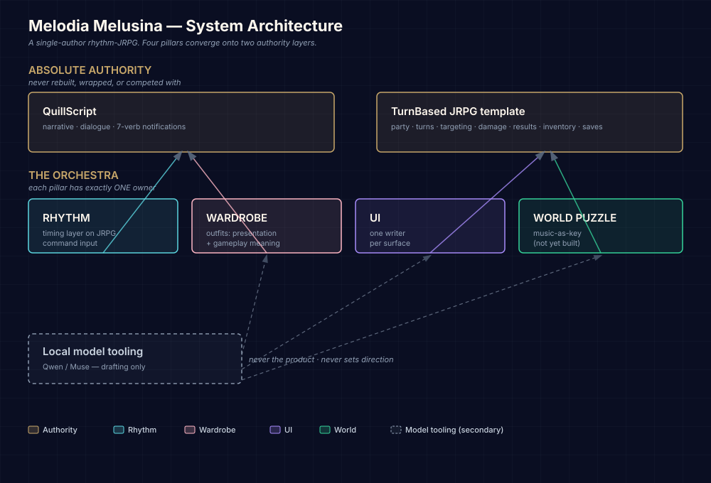

# ♪ Melodia Melusina — Solo UE5.8 Rhythm-JRPG & Technical Art Project

```
✦ ─── ✧ ─── ★ ─── ✧ ─── ✦
```


> **Status:** [CURRENT_STATE.md](CURRENT_STATE.md) is the only status document — what works and at what evidence level, what is open, the owner queue, repositories and workstations. This README describes the project; it does not track status.

## Recruiter / Professor Entry

- **Portfolio:** https://www.fromageart.xyz/
- **Selected Art:** https://fromage3900.github.io/my-site/wix/curated-art.html
- **Resume:** https://fromage3900.github.io/my-site/wix/resume.html
- **Current state and queue:** [CURRENT_STATE.md](CURRENT_STATE.md)

> **Tracked vs Local Assets:** `.gitignore` deliberately keeps bulk raw binary art out of the main repository — LFS is metered (check Settings → Billing) and the live payload at HEAD is 13.3 GB. A fresh clone retrieves the 5,399 curated `.uasset` files rather than all 21,501 development files on the authoring workstation. Deadline check: `python Tools/git_ok.py` — if it is OK, stop; do not spend a day on Git archaeology. Batch/LFS policy remains [Docs/GIT_BATCH_DISCIPLINE.md](Docs/GIT_BATCH_DISCIPLINE.md). Branch hygiene: the branch census, prune receipts, and KEEP decisions live in `Docs/Audits/BRANCH_PRUNE_RECEIPT_2026-09-21.md` and `Saved/Audit/git_health_*.md` (evidence, may be absent from a fresh clone) — read them before re-reviewing old branches.

♪ **Solo-developed rhythm-JRPG vertical slice and environment-led technical-art project in Unreal Engine 5.8 + Blender 5.2.** The repository combines a proven First Dream integration route with reusable character, material, procedural-world, narrative, and capture tooling. Music is the universal key: rhythm timing drives action multipliers on top of turn-based JRPG combat commands, while musical phrase resonance unlocks physical world traversal routes and story portals.

---

## ♪ Core Architecture: Two Authorities & Four Pillars

The Melodia engine architecture converges four distinct gameplay systems onto two authoritative layers:



### Two Absolute Authorities
1. **QuillScript Narrative Authority (`UMelodiaNarrativeSubsystem`)**: Absolute authority on narrative progression, dialogue branches, cutscene triggers, quest flags, and 7-verb structured notifications (`melodia:quest`, `melodia:battle`, `melodia:stat`, `melodia:wardrobe`, `melodia:item`, `melodia:inspect`, `melodia:checkpoint`).
2. **Turn-Based JRPG State Authority (`BP_JRPGSaveGame` & Combat Subsystem)**: Absolute authority on party data, turn order queue, damage calculation, stats, inventory, and canonical game state persistence.

### Four Converged Pillars
1. **Rhythm Combat Layer**: Rhythm timing highway executes directly over JRPG command selections (Attack / Skill / Item / Flee). Player input accuracy (`Poor: 0.35`, `Good: 1.0`, `Great: 1.2`, `Perfect: 1.5`) scales base damage and pulses material parameter collections (`MPC_Melodia_Palette`) without bypassing JRPG turn rules.
2. **Wardrobe Traversal System**: Outfits provide visual customization and implement `IMelodiaTraversalCapabilityProvider` to unlock concrete physical world traversal capabilities (Glide, Swim, Dash), fully preserved across save/reload cycles via `UMelodiaWardrobeSubsystem`.
3. **Music-as-Key World Puzzles**: Environmental barriers and harmonic puzzles respond to played musical phrases (`APCGHeroMusicGraphHost` / Piano node stepping), dispatching 7-verb narrative notifications to unlock physical routes and portal boundaries.
4. **Single-Writer UI Architecture**: Strict UI hierarchy where every surface has exactly one designated writer (`UMelodiaUIBridgeSubsystem`), eliminating race conditions, duplicate overlays, and widget memory leaks.

---

## ♪ P0 Full-Stack Integration Loop

The six-phase route below is the proven **First Dream integration song** used to exercise Melodia end to end. It is **not mandatory pacing for every future chapter**. Later chapters may use different shapes as long as they preserve the stable runtime authorities, IDs, persistence rules, and evidence discipline:

```
┌─────────────────────────────────────────────────────────────────────────────────────────┐
│                        UNIVERSAL CHAPTER GAMEPLAY LOOP TEMPLATE                         │
└─────────────────────────────────────────────────────────────────────────────────────────┘
   │
   ▼
[ Phase 1: Narrative Initiation & Sanctuary Departure ]
   ├── QuillScript dialogue node with chapter key NPC
   ├── Authoring of active quest flag (`quest.<chapter_id>.start`)
   └── Authoring of Sanctuary departure gate unlock
   │
   ▼
[ Phase 2: Overworld Traversal & Music-as-Key Route Unlock ]
   ├── Traversal across overworld using active Wardrobe traversal capabilities
   ├── Discovery of environmental musical puzzle / route barrier
   ├── Player steps on musical nodes / plays resonant melody
   └── Route / portal barrier unlocks via 7-verb narrative notification
   │
   ▼
[ Phase 3: Turn-Based JRPG Combat with Rhythm Command Timing ]
   ├── Seamless encounter transition to battle arena
   ├── Single HUD writer (`UMelodiaUIBridgeSubsystem`) displays command menu
   ├── Player selects action (Attack / Resonance Skill / Item / Flee)
   ├── Harmonix Rhythm Highway engages for real-key timed inputs
   └── Grade multiplier scales stock JRPG damage calculation
   │
   ▼
[ Phase 4: Battle Resolution & Idempotent Reward Distribution ]
   ├── Terminal combat outcome reached (Victory / Defeat / Flee / Timeout)
   ├── QuillScript narrative resumes once
   └── Idempotent reward distribution via Intent-ID (Wardrobe unlock, Stat increase, Item)
   │
   ▼
[ Phase 5: Traversal Upgrade & World Progression ]
   ├── Player equips newly acquired wardrobe piece
   ├── `UMelodiaWardrobeSubsystem` grants new traversal capability (e.g., Glide / Dash)
   └── Player accesses previously unreachable chapter climax portal / landmark
   │
   ▼
[ Phase 6: Canonical Checkpoint & Seamless Chapter Transition ]
   ├── State serialized to `BP_JRPGSaveGame` slot
   ├── Verified round-trip persistence (Party, Stats, Flags, Wardrobe, Inventory)
   └── Level streaming / transition to next Chapter map
```

---

## ♪ Four Active Tracks

### Track 1: Stable Technical Proof — "First Dream"

- **Role:** protect-and-polish professor/reviewer proof; no broad semester expansion.
- **Route:** `/Game/Melodia/Levels/Opening/L_MelusinaMorning` → `/Game/EnvSandbox/Monoliths/SeaAbove/Prototype/LV_SeaAbove_Prototype` → `/Game/EnvSandbox/Environments/L_KaleidoNave`
- **Current evidence:** `CURRENT_STATE.md` §2.
- **Semester rule:** regressions, packaging, presentation, capture quality, and demo rehearsal are in scope; new global frameworks are not.

### Track 2: Fall 2026 Production — "Shorewake Calling"

- **Canonical package:** `Chapters/02_shorewake_calling/`
- **Hero environment:** Shorewake Quay → Reef Choir → Starskiff Mooring.
- **Outputs:** playable 3–5 minute vignette, Melusina acting shot, couture/material treatment, technical-art breakdowns, 60–90 second reel.
- **Academic mapping:** `Docs/Semester/FALL_2026_ACADEMIC_MATRIX.md`.

### Track 3: Model Context Protocol (MCP) & Automation Tooling
- **1330 Typed MCP Actions** across 24 namespaces supporting offline schema inspection and live Unreal Engine automation.
- **Melodia MCP Server (`deploy/melodia_mcp_server.py`):** 38/38 verified unit & regression tests.
- **Melusina Agent Test Harness (MATH):** Strict quantitative evaluation of local models across 5 core metrics:
  - **TCA** (Tool Call Accuracy ≥ 98%)
  - **PAR** (Policy Adherence Rate = 100%)
  - **SCR** (State Convergence Rate ≥ 95%)
  - **RCF** (Recovery from Feedback ≥ 90%)
  - **TER** (Token Efficiency Ratio ≤ 0.20)

### Track 4: ECHO Pipeline & Evidence Ledger
- **Deterministic Pipeline:** `Spec → T3D Inject → Compile → Fingerprint → Regression Test → Promote`
- **Gate Runner:** `Tools/echo_run.py` & `Tools/project_state.py`
- **Evidence policy:** status lives in `CURRENT_STATE.md`; generated `Saved/` ledgers are runtime evidence and may be absent from a fresh clone.

---

## ♪ Repository Map

| Directory | Scope & Contents |
|---|---|
| `Content/Melodia/` | Gameplay assets: levels, characters, save game structures, audio, configuration |
| `Content/EnvSandbox/` | Production environments, Substrate toon materials, PCG scatter ecosystems |
| `Source/BS_GodFile/` | 203 C++/header source files — battle logic, narrative subsystem, wardrobe subsystem, UI bridge |
| `Tools/` | 1564 Python automation scripts — build validation, gate ledger, asset injectors, regression runners |
| `deploy/` | MCP server implementations (`melodia_mcp_server.py`, `agent_bridge_mcp.py`), daemons, build graphs |
| `specs/` | 175 JSON contract schemas — MCP schemas, tool policies, P0 golden run contracts |
| `Plugins/` | 25 active plugins — Monolith, QuillScript, MelodiaWardrobe, UEBlueprintMCP, KawaiiPhysics |
| `Docs/` | Architecture, pipelines, research, evidence, art references, and credits |
| `Saved/` | Gate ledgers (`gate_ledger.json`), audit manifests, and test execution reports |

---

## ♪ Quickstart & Verification

```powershell
# 1. Clone repository
git clone https://github.com/fromage3900/MelodiaMelusinaV2.git
cd MelodiaMelusinaV2

# 2. Pull Git LFS assets
git lfs pull

# 3. Run full automated test suite
.\run_tests.ps1

# 4. Run offline preflight gate verification
& "C:\Program Files\Epic Games\UE_5.8\Engine\Binaries\ThirdParty\Python3\Win64\python.exe" Tools/verify_p0_offline.py

# 5. Run Melodia MCP regression suite
& "C:\Program Files\Epic Games\UE_5.8\Engine\Binaries\ThirdParty\Python3\Win64\python.exe" Tools/test_melodia_mcp.py

# 6. Launch Unreal Engine 5.8 Editor
start BS_GodFile.uproject
```

---

## ♪ Rights & Attributions

### Project Rights
Unless a specific file or bundled third-party component states otherwise, the original **Melodia Melusina** source code, tools, configurations, documentation, and original artwork are © 2026 Brennan Shepherd / fromage3900. **All rights reserved.** No permission is granted to copy, redistribute, republish, scrape for reuse, create derivative works from, or use this original project material for machine-learning/model-training datasets without prior written permission from the copyright holder.

Third-party plugins, libraries, Marketplace/Fab content, CC0 assets, and other external dependencies remain governed by their own licenses and attribution requirements; nothing in this notice overrides those terms.

### Attributions & Provenance
*Melodia* relies on creators across the Unreal Engine Marketplace / Fab, CC0 open-source communities, BOOTH.pm, and original first-party artwork. Every imported asset carries strict provenance tracking including named creator, source repository, and license category.

- **Full Credits & License Ledger:** [Docs/CREDITS.md](Docs/CREDITS.md)
- **Asset Sources Matrix:** [Docs/SOURCES_MATRIX.md](Docs/SOURCES_MATRIX.md)
- **Automated License Gate:** `Tools/credits_gate.py` (enforced via ECHO pipeline)

---

*Melodia © 2026. All rights reserved. Built with Unreal Engine 5.8, Blender 5.2, and Model Context Protocol automation.*
