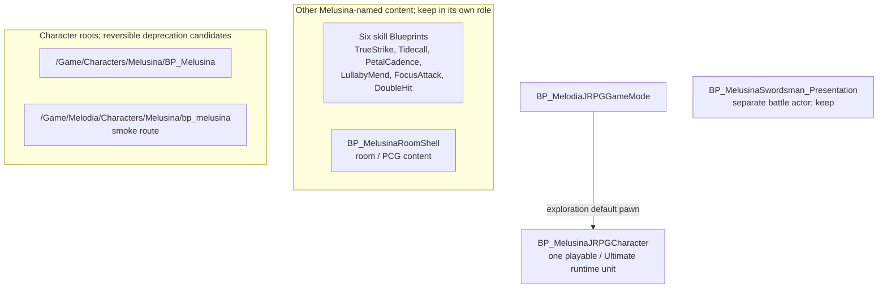
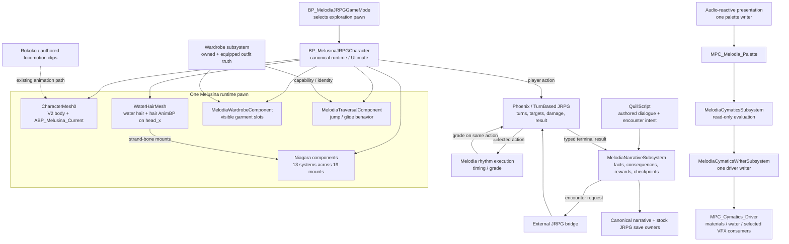
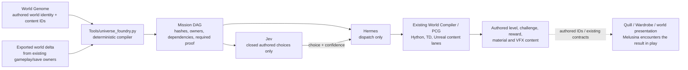

# System Architecture Map — Melodia Melusina

**Last Updated:** 2026-09-23
**Target:** Unreal Engine 5.8 | Blender 5.2 LTS | C++20  
**World-building contract:** [`Docs/WorldBuilding/WORLD_BUILDING_SOURCE_OF_TRUTH.md`](Docs/WorldBuilding/WORLD_BUILDING_SOURCE_OF_TRUTH.md)

---

## 1. Architecture principle

Melodia's long-term growth depends on **stable runtime ownership beneath renewable authored content**.

```text
                         RENEWABLE CONTENT
   Gifts / Reveries / Episodes / Chapters / Movements / Voyages / Volumes
                                      │
                                      ▼
                           CHAPTER PACKAGE LAYER
        stable IDs • progression specs • Quill • content manifests • tests
                                      │
                                      ▼
┌──────────────────────────────────────────────────────────────────────────────┐
│                           STABLE GAMEPLAY CORE                               │
│                                                                              │
│  Phoenix / TurnBased JRPG        Melodia rhythm execution                    │
│  turns • targets • results       timing • phrase quality • presentation     │
│               │                         │                                    │
│               └────────────┬────────────┘                                    │
│                            ▼                                                 │
│                  Wardrobe + Convergence                                      │
│           build identity • interpretation • world response                   │
│                            │                                                 │
│            ┌───────────────┼────────────────┐                                │
│            ▼               ▼                ▼                                │
│       Starskiff        World / Music       UI Bridge                         │
│       traversal        challenges          one writer/surface                │
│            └───────────────┬────────────────┘                                │
│                            ▼                                                 │
│           Narrative / canonical durable state                                │
│  Quill intents • flags • checkpoints • rewards • forward-compatible save    │
└──────────────────────────────────────────────────────────────────────────────┘
```

The same stack, from the C++ ownership diagram:

```text
Data definitions (enums, structs, Data Assets, tables, config)
        ↓
Core C++ systems (Actors, components, subsystems, save, state machines)
        ↓
Gameplay rules (movement, combat, companion, traversal, persistence)
        ↓
Blueprint layer (assemble, iterate, hook events — does not invent truth)
        ↓
Content layer (animation, materials, UI, audio, VFX, levels)
        ↓
Player experience
        ↓
Persistence (SaveGame, narrative record, world state)
```

C++ defines the rules; Blueprints present and connect them. TouchDesigner and Chladni/cymatics visualize owner state. They do not become a second combat, save, or quest authority.

The core should become more stable as content grows. A new Voyage is normally a **content integration problem**, not an excuse to reopen combat/save/UI ownership.

### Content-first boundary (verified 2026-09-14)

The stable gameplay core is already in service of authored content. A boss battle, rhythm skill,
side quest, creature Episode, outfit ability, musical world puzzle, or procedural setpiece normally
uses the owners and entry points above. Before changing architecture, ask whether the experience can
be expressed as content through `CURRENT_STATE.md` -> `PROVEN CREATIVE CAPABILITY SURFACE`. If yes,
author it. Architecture work requires a demonstrated blocker against a named owner seam.

### Melusina character assembly (canonized 2026-09-23)

`/Game/MelodiaIntegration/Blueprints/BP_MelusinaJRPGCharacter` is the canonical exploration
heroine and carries the **Ultimate** designation without an asset rename or duplicate class.
It composes the existing locomotion/Rokoko animation, wardrobe, traversal, and attached Niagara
presentation systems. `/Game/Experiments/MelodiaJRPG/BP_MelusinaSwordsman_Presentation` has a
separate battle-presentation role. The two old character roots are documentation-first deprecation
candidates; skills and the room shell are different content roles. See `CURRENT_STATE.md` for exact
paths, referencer caveats, and proof tiers.

`Tools/universe_foundry.py` is the authoring compiler for content entering existing runtime
contracts. It is not a pawn component or second gameplay authority. Keep the current Niagara
systems as presentation components rather than creating another VFX framework. A polished heroine
should read coherently across exploration and battle, with a visible face, silhouette, outfit,
and motion language.

#### Melusina Blueprint family

The eleven `BP_Melusina*` assets have different jobs. The arrows below show role and selection,
not inheritance. This is the quick route for choosing an asset before opening a Blueprint.



The legacy roots require fresh hard/soft referencer and route checks before any move or deletion.
The six skill Blueprints and room shell are content assets, not alternative playable pawns.

#### Melusina runtime system diagram

This is the **canonical visual map** for Melusina work. Read each box as an owner or assembled
component; an arrow means a defined handoff, not that one system has absorbed the other's state.
For current pass/fail status, read `CURRENT_STATE.md`; for Melusina work gates, read
`Docs/P1_TASK_LEDGER.json` → `melusina_work`.



**How to read the map:** Melusina's Blueprint assembles the playable body, existing animation,
water hair, wardrobe visuals, traversal, and Niagara mounts. QuillScript, JRPG combat, rhythm,
wardrobe inventory, save, and cymatics keep their own owners; the pawn participates in their
contracts. The cymatics arrow to VFX describes the available presentation lane, **not** proof that
each of the 13 attached systems samples the driver. `BP_MelusinaSwordsman_Presentation` is a
separate battle actor, not a second exploration pawn or a parent of this one. The two old
`BP_Melusina` character roots are reversible deprecation candidates pending fresh referencer checks.
Convergence interprets outfit, narrative, rhythm, and world signals through their existing owners;
the UI Bridge displays those owners' state and remains the sole UI writer. Neither adds a second
inventory, quest log, combat result, or save record.

| System | Agent entry point | Ownership boundary |
|---|---|---|
| Runtime identity and body | `/Game/MelodiaIntegration/Blueprints/BP_MelusinaJRPGCharacter`, `CharacterMesh0`, `ABP_Melusina_Current` | Keep the existing GameMode selection and animation owner. |
| Water hair and drips | `WaterHairMesh` + `ABP_Melusina_WaterHair` on `head_x`; the saved canonical BP references `GC_MelusinaHairFlip_TrimmedZ045_20260923` under the hair component at scale `0.01`, looping, with `MI_Melusina_WaterHair_v10` | Saved-template assignment is confirmed. The existing LIVE PIE receipt covers the older cache; verify candidate bounds, full-cycle/restart playback, movement-follow, and visible drip silhouette in fresh `L_MelusinaMorning` PIE before visual acceptance or cache promotion. |
| Outfits and traversal | `UMelodiaWardrobeSubsystem` → `UMelodiaWardrobeComponent` → `MelodiaTraversalComponent` | Inventory/equip truth stays in Wardrobe; traversal executes capabilities. |
| Narrative and battle | QuillScript → `UMelodiaNarrativeSubsystem` → external JRPG bridge → Phoenix/rhythm → typed result back to narrative | Quill owns authored consequence; Phoenix owns damage/turns; rhythm grades the selected action once. |
| Convergence and UI | Existing Convergence seams; `UMelodiaUIBridgeSubsystem` | Interpret and display owned state; do not store a second copy of it. |
| World response | Audio palette → read-only Cymatics → dedicated driver writer → materials/water/eligible Niagara | Keep one writer per palette/driver; confirm each consumer separately. |
| Character FX | 13 `NS_Melusina_*` systems on 19 Blueprint component mounts | Reuse mounted systems; isolated previews and runtime attachment require separate proof. |

#### Universe Foundry integration boundary



Foundry creates **work instructions and content inputs**, never a component or manager on
`BP_MelusinaJRPGCharacter`. The checked-in example is `faraway_mother`: its genome names the
Heart Gate challenge and wardrobe reward, and its compiled mission assigns Jev, Hermes, PCG,
Hython, TouchDesigner, and Unreal tasks. That example uses a `non_authoritative_fixture` delta;
its mission JSON is a compilation receipt, not proof of a real saved-world round trip. The genome's
`resonance_integration_spec` points to
`Docs/Production/FARAWAY_MOTHER_P1_RESONANCE_FIELD_INTEGRATION_SPEC.md`; that spec explicitly
keeps the TD-to-Unreal field return and multi-consumer PIE proof open. `world_compiler_recipe` is
null, so the mission includes a recipe-authoring task. No Melusina-specific world genome or direct
pawn reference exists under `specs/universe/`. The owner confirms the needed gameplay integrations
work; this source review does not rerun them or promote Faraway Mother's open mission gates.
The Faraway genome and PCG sources name `challenge.mother_heart_gate` and
`reward.wardrobe.mother_velvet_mantle`, but those exact IDs were not found in checked-in `.qsc`
sources or `specs/wardrobe/wardrobe_catalog_source.v1.json`. A binary Unreal asset may bind them;
resolve the IDs in the editor before claiming a playable Faraway challenge-to-outfit handoff.

### Production authoring plane (verified 2026-09-21)

The project now has a stable authoring plane above the runtime owners. These tools create or transform content; they do **not** become gameplay/state authorities.

```text
reference / design lock
        ↓
Blender / Geometry Nodes / Houdini / authored world recipe
        ↓
source validation + provenance
        ↓
World Compiler / scoped import / UE-native PCG
        ↓
levels • PCG instances • materials • Niagara • animation presentation
        ↓
existing runtime-owner signals
        ↓
player-visible world response
        ↓
runtime / restart / packaged evidence
        ↓
main
```

Rules:
- `Tools/world_compiler.py` compiles authored world data; it does not own runtime truth or write MPC state;
- UE PCG/material/Niagara are presentation/content consumers of existing gameplay/audio/world semantics;
- Melodia Studio / GN is a DCC authoring source and must be selectively promoted into the production spine;
- a successful generator run is SOURCE/EDITOR evidence until the resulting UE content is exercised live;
- new worlds normally add recipes, assets, chapter data and lookdev—not another compiler or state subsystem.

This page is runtime-ownership detail. [`Docs/Architecture/CURRENT_SYSTEM_MAP.md`](Docs/Architecture/CURRENT_SYSTEM_MAP.md) is a duplicate snapshot, not a second authority.

---

## 2. System ownership

### TurnBased JRPG / Phoenix
Owns combat skeleton and stock gameplay state:

- turn order;
- targeting;
- action resolution;
- HP/MP/stats;
- party/inventory;
- terminal battle result;
- stock gameplay save state it already owns.

**Do not rebuild this in MelodiaCore.**

### Melodia rhythm
Owns rhythm/performance execution and presentation around an already selected action.

Current simple grade-to-damage behavior is a proven baseline, not the ceiling. Future Chapters may interpret rhythm through outfit/Convergence differently, but the selected JRPG action remains authoritative.

### Narrative / Quill
`UMelodiaNarrativeSubsystem` + QuillScript own:

- stable narrative intents;
- quest/objective flags;
- consequences;
- checkpoints;
- exactly-once reward consumption;
- content progression history.

### Wardrobe
`UMelodiaWardrobeSubsystem` owns owned/equipped wardrobe state and exposes mechanical capability/identity.

Outfits can affect:

- traversal;
- rhythm interpretation;
- battle affordances;
- creature/world relationships;
- Convergence response.

### Convergence
Convergence is an **interpretation layer**. It reads owner state and produces authored relationships. It must not become a duplicate inventory, quest log, battle manager, or second save authority.

### Starskiff
Starskiff owns vehicle/traversal behavior. Long-term, it may also be the fiction-facing presentation surface for accumulated journey history (parcels, souvenirs, companion objects), while durable ownership remains in canonical save state.

### UI Bridge
One writer per surface. New Chapters/Voyages may add screens but not parallel UI ownership.

---

## 3. Chapter package boundary

A future Chapter should arrive as data/content around the stable core:

```text
specs/progression/<chapter>.v1.json
+ optional wardrobe/world/encounter/audio manifests
+ Quill source if needed
+ stable IDs
+ authored maps/assets
+ offline tests
+ runtime/restart/package evidence
```

A Chapter may use only the systems it needs.

Examples:

- Reverie: Quill + exploration + save;
- creature Episode: rhythm + world interaction + consequence;
- combat Chapter: Phoenix + rhythm + Wardrobe/Convergence;
- Starskiff Chapter: traversal + party dialogue + world state;
- Monolith Event: authored world transitions + traversal, no conventional boss HP required.

The old six-phase P0 chain is a **full-stack integration pattern**, not a mandatory chapter script.

---

## 4. Long-term update boundary

Optional future online support belongs **outside** the stable gameplay core.

```text
optional remote manifest
        ↓
validated Gift/Voyage availability
        ↓
existing idempotent reward/content ownership path
        ↓
canonical local save history
```

If the network is unavailable, core game and owned content continue to work.

Do not put turn resolution, wardrobe ownership, narrative progression, or normal save/load behind a service dependency.

---

## 5. Production hierarchy

### Permanent systems
Phoenix, rhythm execution, Narrative, Wardrobe, Convergence seams, Starskiff traversal, UI ownership, persistence, chapter loader/validation.

### Renewable authored content
Chapters, Reveries, creatures, outfits, regions, Monolith Events, world puzzles, dialogue, Voyages, gifts.

When deciding whether to add code, ask:

> Can this be expressed as content using the stable owners we already have?

If yes, prefer that.

---

## 6. Current closure target

```text
Wardrobe
   ↓
Starskiff / exploration
   ↓
Phoenix action
   ↓
Rhythm execution
   ↓
Convergence / consequence
   ↓
checkpoint / reward
   ↓
canonical save
   ↓
full process restart
   ↓
restore exact durable state
   ↓
repeat load with no duplication
```

Closing this loop is more important than adding another global subsystem.

---

## 7. Strategy references

- `Docs/Strategy/MELODIA_ENDLESS_JOURNEY_NORTH_STAR_2026-09-02.md`
- `Docs/Strategy/MELODIA_CHAPTER_TIER_AND_VOLUME_ARCHITECTURE_2026-09-02.md`
- `Docs/Strategy/MELODIA_EVERGREEN_CONTENT_AND_GIFT_MODEL_2026-09-02.md`
- `Docs/WorldBuilding/WORLD_BUILDING_SOURCE_OF_TRUTH.md`
- `CURRENT_STATE.md`
- `DOC_INDEX.md`

**Architecture goal:** years from now, most new Melodia work should look like authoring a journey, not repairing the engine underneath it.
